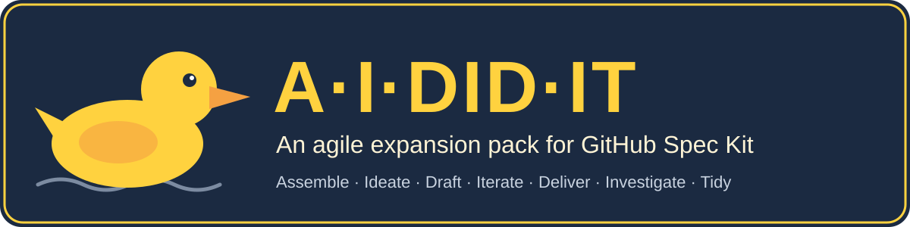
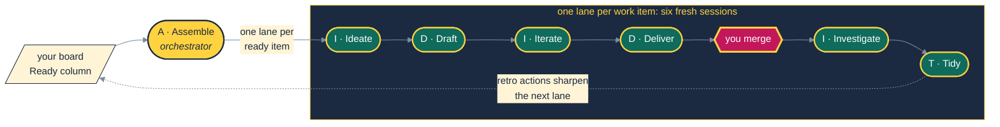

<p align="center">
  
</p>

<p align="center">
  <a href="https://github.com/RubberDuckEngineering/ai-did-it/actions/workflows/ci.yml"></a>
  <a href="LICENSE"></a>
  <a href="https://github.com/github/spec-kit"></a>
</p>

# AI Did It

**A·I·DID·IT** is an agile expansion pack for [GitHub Spec Kit](https://github.com/github/spec-kit).
Spec Kit gives your coding agent a spec-driven loop: specify, plan, tasks, implement
([Spec Kit](docs/sources.md#spec-driven)). AI Did It wraps that loop in a whole delivery lifecycle.
A simulated agile team (product owner, architect, QA, DevSec, DevOps) reviews the work. A panel of
software practitioners makes the decisions you would otherwise be paged for. You keep exactly one
job: clicking **merge**.

> Assemble the lanes. Ideate the work. Draft the bet. Iterate to build it. Deliver it to users.
> Investigate what actually happened. Tidy what you learned.



## 🦆 Why a Duck, Why a Lifecycle

Hand an agent a whole feature in one long conversation and the same things go wrong every time.
The context fills up and quality slips quietly ([Liu et al.](docs/sources.md#liu-2024);
[Hong, Troynikov & Huber](docs/sources.md#hong-2025)). Early decisions get forgotten. The tests end
up agreeing with the code instead of checking it. And you get interrupted for every judgement call.

AI Did It answers each of those with a published practice:

| Problem | Practice | Standing on |
|---|---|---|
| One context doing everything | **Lanes.** Each work item runs as a chain of six short, single-purpose sessions joined by a written handoff note. | [Small batches](docs/sources.md#reinertsen-2009), [continuous delivery](docs/sources.md#humble-farley-2010) |
| Endless revise loops | **Loop budgets.** Clarify and analyze run at most 3 rounds, exit early when nothing CRITICAL or HIGH remains, then the panel rules once. | Timeboxing |
| You as the bottleneck | **The practitioner panel.** Beck, Fowler, Farley, Dahan and Martin, each position web-cited and checked, decide what you would normally be asked. | [Independent judgement](docs/sources.md#surowiecki-2004), [anchoring](docs/sources.md#tversky-kahneman-1974) |
| Tests that agree with the code | **TDD with kill tests.** Every guard needs a recorded mutation that turns it red, and a run that shows it green. | [Beck](docs/sources.md#beck-2002), [mutation testing](docs/sources.md#demillo-1978) |
| "It merged, so it works" | **Investigate.** The null hypothesis is that the delivery failed; the change is checked against the running system. | [Dijkstra](docs/sources.md#dijkstra-1970), [Popper](docs/sources.md#popper-1959) |
| Lessons that evaporate | **Retros that act.** Every lane link before Tidy ends with a retro, and Tidy turns its actions into new work items. | [Kerth](docs/sources.md#kerth-2001), [Deming](docs/sources.md#deming-1986) |

The duck is a nod to rubber-duck debugging ([Hunt & Thomas](docs/sources.md#hunt-thomas-1999)):
explaining your work out loud to something that listens. Here, the duck listens, then files a PR.

## 🚀 Quick Start, Quacking

You need Python 3.11 or later, [uv](https://docs.astral.sh/uv/), git, and a coding agent that Spec
Kit supports (Claude Code, GitHub Copilot, Gemini CLI, Codex, Cursor, opencode and more).

```bash
uv tool install git+https://github.com/RubberDuckEngineering/ai-did-it
```

That one command installs the `aididit` CLI **and** Spec Kit (`specify-cli` 1.3+) into the same tool
environment. Then, in your project:

```bash
aididit doctor
```

```bash
aididit install --integration claude
```

`install` runs `specify init` if the folder is not a Spec Kit project yet, adds the pack, seeds a
starter Kanban board at `.specify/aididit/board.md`, and registers the single-lane workflow. Running it
again upgrades in place and keeps your config and your board. [The CLI page](docs/cli.md) draws
every step.

Now talk to your agent:

| You want to… | Say |
|---|---|
| Turn an idea into a well-formed story | `/speckit.aididit.ideate I want users to export their data` |
| Ship everything in the Ready column | **"Agents Assemble"** (or `/speckit.aididit.assemble`) |
| Walk one item through every stage, approving each hand-off | `specify workflow run aididit-lane` |
| Run one stage by hand | `/speckit.aididit.draft`, `/speckit.aididit.iterate`, … |
| Ask a teammate | `/speckit.aididit.architect`, `/speckit.aididit.qa`, … |

Command syntax depends on your agent. Claude Code shows them as `/speckit-aididit-ideate`; Spec Kit
renders the right form for each agent at install time. Every command lives in the pack's own
`speckit.aididit.*` namespace, so nothing collides with Spec Kit's core commands or another
extension's.

## 🧭 The Field Guide

| Read | For |
|---|---|
| [The walkthrough](docs/walkthrough.md) | The whole system in one read, and why it has this shape |
| [The lifecycle](docs/lifecycle.md) | Lanes, the handoff baton, loop budgets, who decides what |
| [The seven stages](docs/stages.md) | Every stage drawn as a flow |
| [The panel](docs/panel.md) | How cited rulings are made, and when a human is called |
| [Boards and lanes](docs/board-and-lanes.md) | Board columns and providers, lane runners, the spawn scripts |
| [The CLI](docs/cli.md) | `install`, `uninstall`, `doctor`, step by step |
| [The brand book](docs/brand.md) | The palette, the diagram rules, the voice, and why it all works in dark mode |
| [The kill-test ledger](docs/kill-tests.md) | Every guard in this repo, shown red and shown green |
| [Sources](docs/sources.md) | Every citation, checked and dated |

## 🔤 The Lifecycle at a Glance

| | Stage | Command | What happens |
|---|---|---|---|
| **A** | Assemble | `speckit.aididit.assemble` | Read the board, group items by file overlap, start one lane per item, report. |
| **I** | Ideate | `speckit.aididit.ideate` | **Mode A** (you): Socratic, one question at a time, cite-or-don't-suggest. **Mode B** (a lane): interrogate an accepted item's premises, scope and testability before any drafting. |
| **D** | Draft | `speckit.aididit.draft` | specify → clarify loop → plan → tasks → analyze loop → team review. Produces `spec.md`, `plan.md`, `tasks.md`, contracts and ADRs. |
| **I** | Iterate | `speckit.aididit.iterate` | TDD red/green/refactor, Conventional Commits, push, open the PR, post-implementation analyze. |
| **D** | Deliver | `speckit.aididit.deliver` | Panel review and bot review on the PR, resolve threads, drive checks green, **stop for the merge**. |
| **I** | Investigate | `speckit.aididit.investigate` | Verify the merged change against the running system; verdict CLEAR / DEGRADED / REGRESSED / UNVERIFIABLE. |
| **T** | Tidy | `speckit.aididit.tidy` | Close the item, triage the board, turn retro actions into new work. |

The agent-facing reference is [`shared/lifecycle.md`](src/aididit/pack/shared/lifecycle.md).

## 👥 The Simulated Team

| Role | Command | Brings |
|---|---|---|
| Product Owner | `speckit.aididit.po` | Story shaping and slicing ([INVEST](docs/sources.md#wake-2003)), Given-When-Then acceptance criteria ([North](docs/sources.md#north-2006)), priority calls |
| Architect | `speckit.aididit.architect` | Design adjudication, [ADRs](docs/sources.md#nygard-2011), boundaries and coupling |
| QA | `speckit.aididit.qa` | Test strategy, acceptance tests, test-quality review ([Test Desiderata](docs/sources.md#beck-desiderata)) |
| DevSec | `speckit.aididit.devsec` | Threat modelling, [OWASP Top 10](docs/sources.md#owasp-top10), least privilege, secret hygiene |
| DevOps | `speckit.aididit.devops` | Pipelines, infrastructure as code, deployability, observability |
| PR Prep | `speckit.aididit.pr-prep` | Gets a branch review-ready before the PR opens |
| PR Review | `speckit.aididit.pr-review` | Structured review using [Conventional Comments](docs/sources.md#conventional-comments) |

On top of the roles sits [the practitioner panel](docs/panel.md). It is convened fresh for each
decision. A position without a verified citation is labelled `[Inference]` and cannot decide
anything on its own. The personas simulate published positions. None of the practitioners has
reviewed or endorsed this project.

## ⚙️ Configuration

`.specify/extensions/aididit/aididit-config.yml` is created on first install and kept on upgrade:

| Key | Default | Meaning |
|---|---|---|
| `board.provider` | `markdown` | `markdown` (a Kanban file in the repo), `github` (Issues via `gh`), or `jira` (needs an Atlassian MCP server) |
| `lanes.runner` | `inline` | `inline` (current session runs each link, works with every agent), `claude` (detached headless sessions), `claude-remote` (sessions you can watch and steer from Claude Desktop or mobile) |
| `lanes.max_parallel` | `3` | Lane cap for one Assemble run, a work-in-progress limit ([Little](docs/sources.md#little-1961)) |
| `panel.practitioners` | Beck, Fowler, Farley, Dahan, Martin | Who sits on the panel |
| `loops.clarify_max_rounds` / `loops.analyze_max_rounds` | `3` / `3` | Loop budgets |
| `delivery.merge` | `human` | `auto` turns on Full Auto Mode: the Deliver link merges its own PR once every check is green and every thread resolved |

Project-owned state (the board, retros, lane ledgers) lives in `.specify/aididit/`, so it survives
upgrades and uninstalls. Lane ledgers are git-ignored working state; retros are committed on each
lane's branch, and the board file is yours to commit. No lane commits it, so parallel PRs never
conflict over it.

## 💻 The CLI

| Command | Does |
|---|---|
| `aididit install [PROJECT] [--integration AGENT] [--no-init]` | Initialise Spec Kit if needed, add or upgrade the pack, seed the board |
| `aididit uninstall [PROJECT] [--keep-config]` | Remove the pack and lane workflow; keep `.specify/aididit/` |
| `aididit doctor` | Check Python, Spec Kit, git (required) and gh, claude (optional) |
| `aididit --version` | Print the version |

Already living in Spec Kit and prefer its own tooling? Run `specify extension add aididit --from
<zip URL>` with the `aididit-vX.Y.Z.zip` asset of [the latest release](https://github.com/RubberDuckEngineering/ai-did-it/releases/latest),
or clone this repo and run `specify extension add --dev src/aididit/pack`. Either way, the first
stage that reads the markdown board creates `.specify/aididit/board.md` from the starter template
if it is missing, and never overwrites one that is there.

## 🗂️ Repository Layout

Everything is organised by feature, not by technical layer ([Bogard](docs/sources.md#bogard-2018)):

```text
src/aididit/
├── cli.py                    # argument parsing only; routes verbs to feature slices
├── features/
│   ├── install/              # init → add pack → seed state → register workflow
│   ├── uninstall/
│   └── doctor/
└── pack/                     # the Spec Kit extension, copied to .specify/extensions/aididit/
    ├── extension.yml
    ├── aididit-config.template.yml
    ├── stages/<stage>/       # one folder per lifecycle stage
    ├── personas/<role>/      # one folder per simulated teammate
    ├── shared/               # lifecycle, lane contract, panel, board adapters, retro, disciplines
    ├── scripts/              # lane spawners (bash + PowerShell)
    ├── templates/board.md
    └── workflows/aididit-lane.yml
docs/                         # the field guide (for people); the pack is for agents
tests/                        # mirrors the slices, plus pack, diagram, link, PII and end-to-end suites
tools/                        # maintainer tools: the release zip, the commit identity and time-zone checks, and the range CI checks
```

## 🧪 Developing

```bash
uv sync
```

```bash
uv run pytest
```

The suite has six layers:

- **Unit** tests cover each feature slice at 100% branch coverage.
- **Pack contract** tests check that every cross-reference, command token and config key in the
  prompts resolves.
- **Diagram** tests hold every Mermaid diagram to [the house style](docs/brand.md) and re-measure
  its contrast against GitHub's light and dark themes.
- **Link** tests resolve every relative link and every citation anchor.
- **PII** tests keep personal data out of the repo, and `tools/check_commit_identity.py` keeps it
  out of commit authors and committers. `tools/check_commit_timezone.py` holds commits made as the
  project to UTC, so their dates say when, never where. CI runs both over the commits a pull request
  or push brings (`tools/commit_range.py`), so a commit on `main` is judged once, when it lands.
- **End-to-end** tests drive the real `specify` against a throwaway project.

See [CONTRIBUTING.md](CONTRIBUTING.md) for the rules every change follows. They come from the pack
itself: TDD, [Conventional Commits](docs/sources.md#conventional-commits), and guards that can both
fail and pass. Anyone can open an issue; pull requests are open to collaborators, and every change
to `main` needs a maintainer's approval.

## 🙏 Credits

Built on [GitHub Spec Kit](https://github.com/github/spec-kit) (MIT). The method stands on published
work by Kent Beck, Martin Fowler, Dave Farley, Udi Dahan, Robert C. Martin and Ron Jeffries, among
[many others](docs/sources.md). Any mistakes in applying it are ours.

## 📄 License

[MIT](LICENSE)
