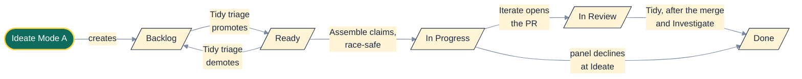
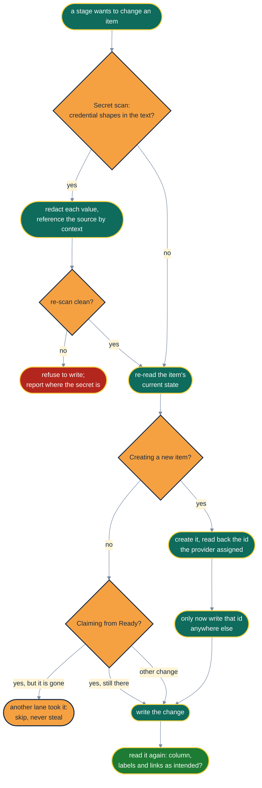
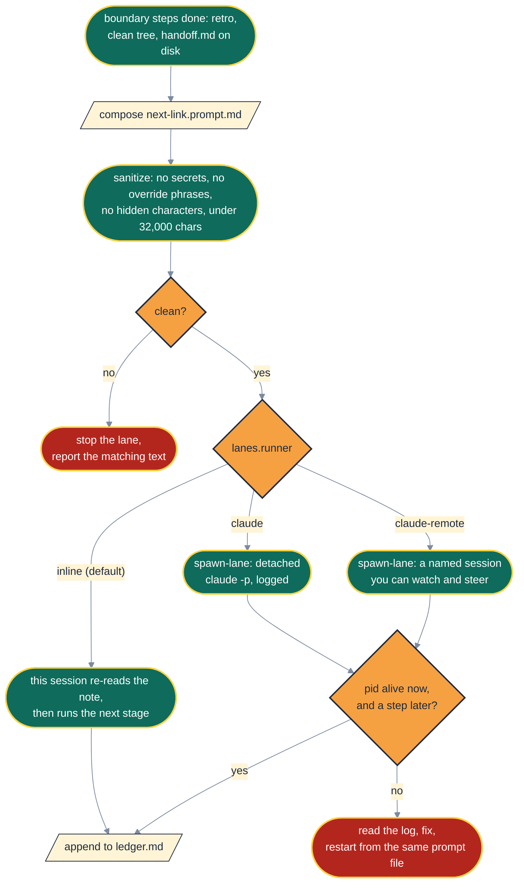
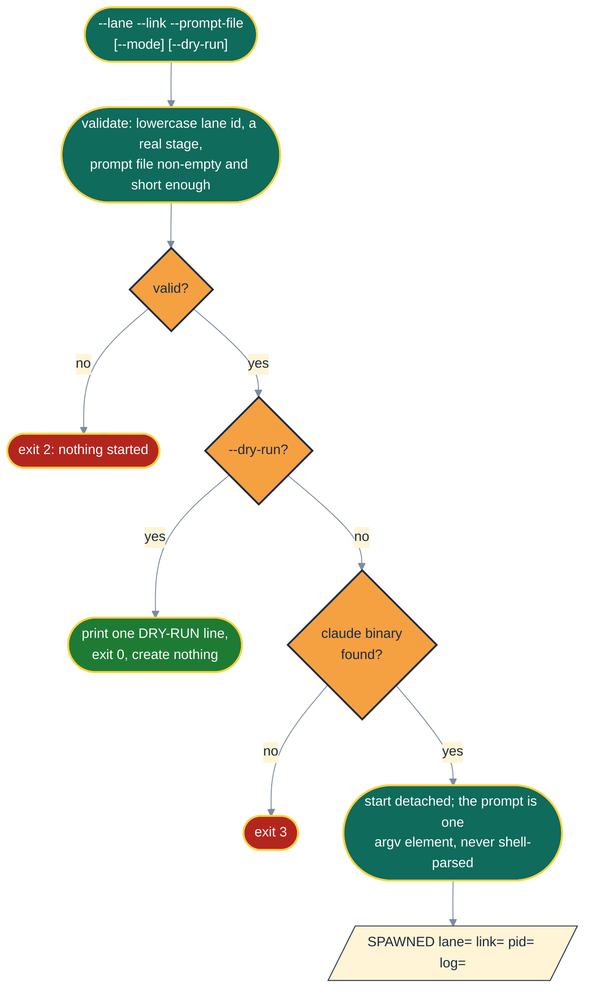

# 🗂️ Boards, Batons and Background Sessions

> Kanban's first rule is to make the work visible. An agent's first instinct is to work invisibly
> in a context window nobody else can read. This page is about who wins that fight.

Two pieces of plumbing keep a fleet of agents honest. The **board** says what work exists and
where it is. The **lane runner** says how each link of a lane starts, and makes sure you can see it
running. The agent-facing rules are in
[`shared/board-adapters.md`](../src/aididit/pack/shared/board-adapters.md) and
[`shared/lane-runner.md`](../src/aididit/pack/shared/lane-runner.md).

## 📋 Five Columns, One Direction

Every board provider maps onto the same five columns. Each move is made by a specific stage, so
the board shows where every item is without anyone updating it by hand.

Visualising the work and limiting work in progress are the two habits Kanban starts from
([Anderson](sources.md#anderson-2010)). `lanes.max_parallel` is the work-in-progress limit for one
Assemble run. Little's law explains why a lower limit helps: for a stable system, the average time
an item spends in progress grows with the number of items in progress
([Little](sources.md#little-1961)).

| Provider | `board.provider` | Where items live | Needs |
|---|---|---|---|
| Markdown (default) | `markdown` | `.specify/aididit/board.md`, one `### AID-<n>` block per item | nothing |
| GitHub Issues | `github` | issues labelled `board.github_ready_label` | `gh`, authenticated |
| Jira | `jira` | project `board.jira_project_key`, ready status `board.jira_ready_status` | an Atlassian MCP server |

## ✍️ Writing to a Board Without Lying to It

Every board write follows the same small protocol. It is boring by design: a board that drifts from
reality is worse than no board, because people trust it.

**Create before cite.** A forecast id ("this will probably be AID-43") is never written, because if
the forecast is wrong it points at a different, real item. **Comment before a terminal move.** A
declined item gets its closure comment first and its move second, so it never reads as delivered
without an explanation.

## 🏃 Lane Runners: How the Next Link Starts

| Runner | Fresh context per link | You can watch it | Works with |
|---|---|---|---|
| `inline` | no: the note and a deliberate re-read stand in for it | in your current session | every agent Spec Kit supports |
| `claude` | yes | `tail -f` the link's log, plus `ledger.md` | Claude Code |
| `claude-remote` | yes | as a named session in the Claude desktop and mobile apps | Claude Code with Remote Control |

**Prompts are treated as untrusted.** A prompt may travel on a process command line and end up in a
log, so it passes the pack's one secret scan before it is written: each value is redacted and its
source referenced by context, and text that still matches after that is never written. Text that
tries to override the
receiving agent's instructions stops the lane. Work-item bodies are wrapped as untrusted data, in
line with OWASP's guidance on handling untrusted input ([OWASP](sources.md#owasp-top10)).

## 🚀 The Spawn Script, Step by Step

`scripts/bash/spawn-lane.sh` and `scripts/powershell/spawn-lane.ps1` behave the same way:

The binary is `$AIDIDIT_CLAUDE_BIN` if set, otherwise `claude` on `PATH`. The prompt is always
passed as a single argument and never handed to a shell, so a work item
containing `$(rm -rf ~)` stays a string. On Windows the PowerShell script refuses `.cmd` and `.bat`
shims, because `cmd.exe` would re-parse the prompt as shell syntax.

## 🗃️ What Lives Where

```mermaid
%%{init: {"theme": "base", "themeVariables": {"fontSize": "15px", "primaryColor": "#FFF4D6", "primaryTextColor": "#1B2A41", "primaryBorderColor": "#1B2A41", "textColor": "#1B2A41", "lineColor": "#7C8BA1", "edgeLabelBackground": "#FFF4D6", "clusterBkg": "#1B2A41", "clusterBorder": "#FFD23F", "titleColor": "#FFD23F"}}}%%
flowchart LR
    subgraph EXT[".specify/extensions/aididit/ (replaced on upgrade)"]
        direction TB
        X1[/"extension.yml, stages,<br/>personas, shared docs"/]:::note
        X2[/"aididit-config.yml<br/>(kept on upgrade)"/]:::note
    end
    subgraph STATE[".specify/aididit/ (yours, survives uninstall)"]
        direction TB
        S1[/"board.md: yours to commit,<br/>never a lane's"/]:::note
        S2[/"lanes/lane-id/: handoff.md, ledger.md,<br/>upstream.md, prompts and logs: git-ignored"/]:::note
    end
    subgraph TREE["your repo"]
        direction TB
        T1[/"specs/NNN-feature/:<br/>spec, plan, tasks, decisions"/]:::note
        T2[/"retros: committed on<br/>each lane's branch"/]:::note
    end
    EXT ~~~ STATE ~~~ TREE
    classDef note fill:#FFF4D6,color:#1B2A41,stroke:#1B2A41,stroke-width:1px
```

## 🥡 Takeaways

- Five columns, and each move belongs to a named stage.
- Create before cite, re-read before write, comment before a terminal move.
- `inline` works everywhere; `claude` and `claude-remote` give each link a fresh context.
- Every spawned link is checked for a live pid and logged. An invisible lane counts as a failed lane.
