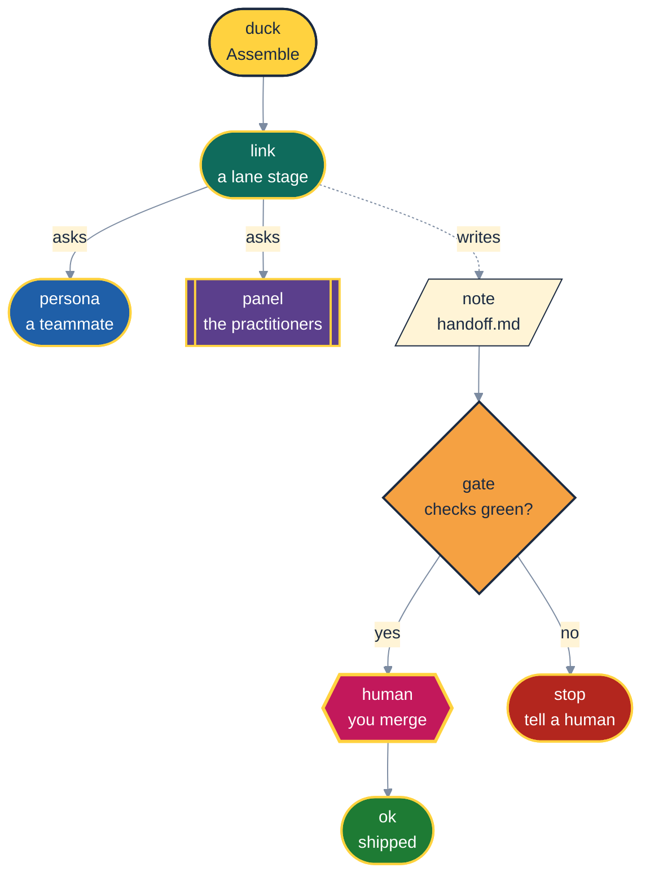

# 🦆 Ducks in a Row: the Brand Book

> Programmers have long explained their bugs to a rubber duck, and the duck has never once
> interrupted with a status meeting. ([Hunt & Thomas](sources.md#hunt-thomas-1999))

This page sets the house style for AI Did It's docs: the name, the palette, the diagram header and
the voice. The first diagram on this page is the **single source of truth** for diagram styling.
`tests/test_diagrams.py` reads it and holds every other Mermaid diagram in the repo to it.

## 🏷️ Naming, Neatly

| Write | When you mean |
|---|---|
| **A·I·DID·IT** | The seven-stage lifecycle: **A**ssemble, **I**deate, **D**raft, **I**terate, **D**eliver, **I**nvestigate, **T**idy |
| **AI Did It** | The product and this repository |
| `aididit` | The CLI and the Python package |
| `speckit.aididit.<command>` | A command as Spec Kit names it; your agent may render it differently (Claude Code shows `/speckit-aididit-draft`) |

The joke in the name is the point: the agents did it, and **you** still decide what goes into your
trunk. Nobody gets to hide behind "AI did it" at the merge button.

## 🎨 Palette with a Purpose

Every colour means one thing, and every diagram uses the same meanings. Shapes carry meaning too, so
a reader with a colour-vision deficiency can still tell a decision from a stage.

| Class | Fill | Text | Stroke | Text contrast | Light | Dark | Dark dimmed | Black |
|---|---|---|---|---|---|---|---|---|
| `duck` | `#FFD23F` | `#1B2A41` | `#1B2A41` | 10.00 | 14.44 | 13.11 | 10.31 | 14.54 |
| `link` | `#0F6B5C` | `#FFFFFF` | `#FFD23F` | 6.41 | 6.41 | 13.11 | 10.31 | 14.54 |
| `gate` | `#F5A142` | `#1B2A41` | `#1B2A41` | 6.92 | 14.44 | 9.06 | 7.13 | 10.06 |
| `human` | `#C2185B` | `#FFFFFF` | `#FFD23F` | 5.87 | 5.87 | 13.11 | 10.31 | 14.54 |
| `panel` | `#5B3F8C` | `#FFFFFF` | `#FFD23F` | 8.29 | 8.29 | 13.11 | 10.31 | 14.54 |
| `stop` | `#B3261E` | `#FFFFFF` | `#FFD23F` | 6.54 | 6.54 | 13.11 | 10.31 | 14.54 |
| `ok` | `#1E7B34` | `#FFFFFF` | `#FFD23F` | 5.33 | 5.33 | 13.11 | 10.31 | 14.54 |
| `note` | `#FFF4D6` | `#1B2A41` | `#1B2A41` | 13.18 | 14.44 | 17.27 | 13.58 | 19.16 |
| `persona` | `#1F5FA8` | `#FFFFFF` | `#FFD23F` | 6.44 | 6.44 | 13.11 | 10.31 | 14.54 |

"Text contrast" is text against its own fill. The last four columns measure how well the node
stands out from each page background, using whichever of its fill or stroke contrasts more. The
numbers come from the WCAG 2.2 formula. They were computed on 2026-11-05 by the same functions the
tests call.

| Shape | Means |
|---|---|
| `([ stadium ])` | a stage or a step that runs |
| `{ diamond }` | a decision |
| `{{ hexagon }}` | a human gate |
| `[[ subroutine ]]` | the practitioner panel |
| `[/ parallelogram /]` | a file on disk (a handoff note, a board, a retro) |

## 🌗 Light, Dark, and Measured

"Works in dark mode" is easy to claim and easy to break. So it is measured, and the measurement
is a test that has to pass on every change:

- **Text needs 4.5:1 against its own fill.** This is WCAG 2.2 success criterion 1.4.3
  ([WCAG 2.2](sources.md#wcag-22)). Every node fill is opaque, so its text never depends on the
  page behind it.
- **Shapes need 3:1 against the page.** This is SC 1.4.11, non-text contrast. Dark fills wear a
  duck-yellow outline. On a white page the fill carries the contrast; on a dark page the outline
  does. Light fills wear a navy outline for the same reason, in reverse.
- **Text never floats.** Edge labels sit on an opaque cream chip and group titles on a navy band.
  For the same reason only `flowchart` diagrams are allowed. Sequence and state diagrams print
  message text straight onto the page, and no single colour reads well on both white and near-black.
- **The pages are GitHub's own.** The backgrounds come from GitHub's Primer design tokens
  ([Primer](sources.md#primer)): light `#FFFFFF`, dark `#0D1117`, dark dimmed `#212830`. Pure black
  stands in as a lower bound for the high-contrast dark themes.
- **Diagrams fit the column.** GitHub draws a diagram in a frame as wide as the page column, 838 px
  for the README on the repository's home page. A wider diagram is shrunk to fit, but the frame is
  sized to the shrunk height while the drawing keeps its full height, so the bottom is cut off. On
  2026-11-11 that cut 18 of 34 diagrams on a 1280 px screen. So diagrams run top to bottom, wrap
  their labels, and split a fan of four or more onto two rows with `~~~` links. The init line also
  trims Mermaid's padding from 48 px to 8 px a side. A phone's column is about 346 px, which almost
  no diagram fits, so phones still crop; only GitHub can fix that.

GitHub renders Mermaid in Markdown ([GitHub Docs](sources.md#github-diagrams)). The init line
selects Mermaid's `base` theme, the one designed to be re-coloured through `themeVariables`
([Mermaid](sources.md#mermaid-theming)). That keeps the colours the same in every viewer, instead
of following whatever theme the viewer picks.

## 🧩 The House Header, Handled

Every diagram starts with the init line from the palette diagram above, copied exactly, and
declares only the `classDef` lines it uses, also copied exactly. In practice:

1. Copy the palette diagram's first line as your diagram's first line.
2. Write `flowchart TB` on the second line. Use `flowchart LR` only for a short chain.
3. Tag nodes with `:::duck`, `:::link`, `:::gate` and so on.
4. Paste the matching `classDef` lines from the palette diagram at the bottom.
5. Run `uv run pytest tests/test_diagrams.py`, then measure the width with
   `uv run --group diagrams pytest tests/test_diagrams.py -m diagrams` (needs Microsoft Edge).

The test rejects a diagram that:

- changes the init line;
- invents or recolours a class;
- uses a class it never defines;
- paints with `style` or `linkStyle`;
- is not a flowchart;
- is wider than 838 px when drawn with the Mermaid build and settings GitHub uses (12.2.0).

It also re-measures the palette itself, so recolouring a class here fails the build if the new
colour cannot pass the contrast bars. Every stage also has to have a flow in
[the stage guide](stages.md), so adding a stage without a diagram fails too.

## 🗣️ Voice, Verified

- **Fun, never fuzzy.** Puns are welcome. A pun that replaces a fact is not.
- **Alliterate the headings.** It helps people remember them, and it is fun to write.
- **Cite or label.** A claim that leans on someone else's work links to
  [the sources page](sources.md). A claim that goes further than its source is labelled
  `[Inference]`. An unchecked claim is labelled `[Unverified]`. Practitioners are cited for
  what they published, never for an endorsement of this project.
- **Numbers carry a date.** A count, a size or a pass rate is "as at" a commit or a date, because a
  measurement taken before something has settled cannot tell "not yet" from "never".
- **No people, no places.** The docs never name a contributor or a private system. The PII test
  enforces that, and it scans this page too.
