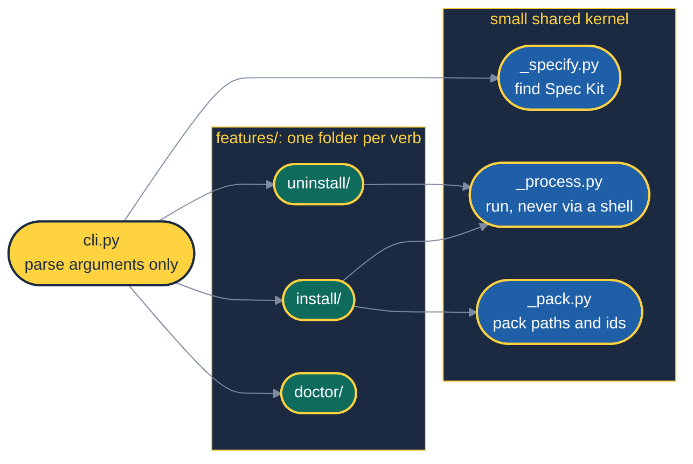
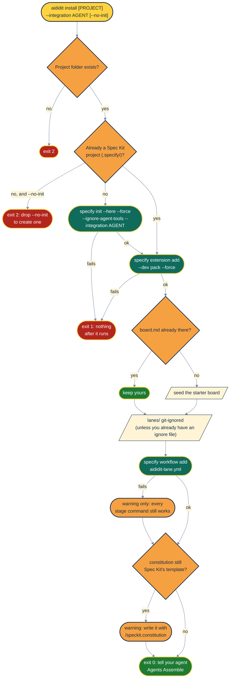
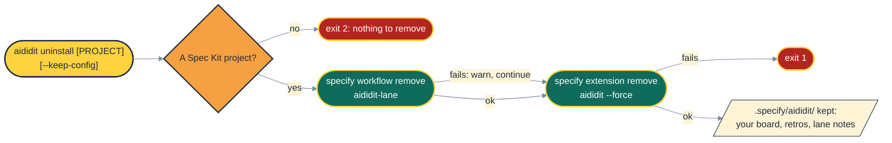
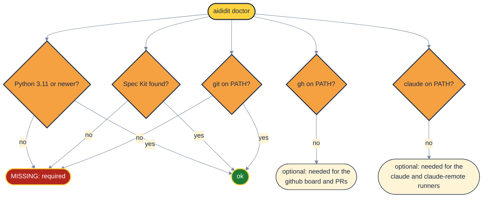
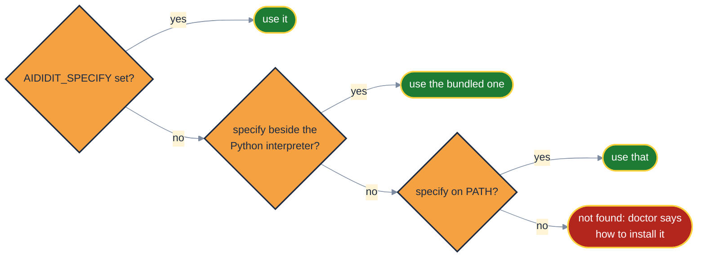

# 🛠️ The CLI, Close Up

> The best installer is one you run twice without fear.

`aididit` is a small Python CLI with three verbs. Each verb is a vertical slice: its own folder,
its own tests, and no shared "services" layer to wade through. This page draws what each verb does,
step by step.

## 🧱 Sliced by Feature, Not by Layer

Organising by feature keeps everything one change needs in one place, and keeps unrelated
features from coupling to each other ([Bogard](sources.md#bogard-2018)). The idea is older than
the name: Parnas argued in 1972 for decomposing a system around the decisions likely to change, not
around the steps of a flowchart ([Parnas](sources.md#parnas-1972)). Each slice receives its
dependencies (a runner, a `say` function, the `specify` command) as arguments, so the tests can
swap in fakes without patching anything.

## 📦 `aididit install`: Idempotent by Design

Run it again any time to upgrade. Spec Kit keeps your `aididit-config.yml`, and the installer keeps
your board and your ignore file. `--ignore-agent-tools` matters more than it looks: without it Spec
Kit refuses to initialise when the agent's own CLI is not on `PATH`. That describes most CI runners
and every IDE-only assistant. This repo's own CI caught the problem on the first push
(see [the kill-test ledger](kill-tests.md), row 20).

The constitution check is a warning, not a stop. The practitioner panel judges scope against
`.specify/memory/constitution.md`, so a constitution that still reads `[PROJECT_NAME]` makes every
one of those checks empty. A fresh `specify init` leaves exactly that template, so expect the warning
on a new project until you write it.

## 🧹 `aididit uninstall`: Leave the Furniture

Uninstall removes the pack and never touches your work. The board and lane history are yours. They
also outlive a reinstall, so `uninstall` followed by `install` is a clean upgrade path.

## 🩺 `aididit doctor`: Check Before You Wreck

## 🔎 Finding Spec Kit

`uv tool install` puts Spec Kit's `specify` next to the `aididit` interpreter, so the CLI looks
there before it trusts whatever happens to be first on `PATH`
([uv](sources.md#uv)).

## 🔢 Exit Codes

| Code | Meaning |
|---|---|
| `0` | done |
| `1` | a step failed and nothing after it ran, or `doctor` found a required tool missing |
| `2` | a precondition failed before anything ran: a missing folder, `--no-init` on a folder that is not a Spec Kit project, or `uninstall` on one |

## 🥡 Takeaways

- Three verbs, three slices, one tiny shared kernel.
- `install` is safe to repeat: it never overwrites your board, config or ignore file.
- `uninstall` removes the pack and keeps your work.
- `doctor` separates what is required from what is merely useful.
