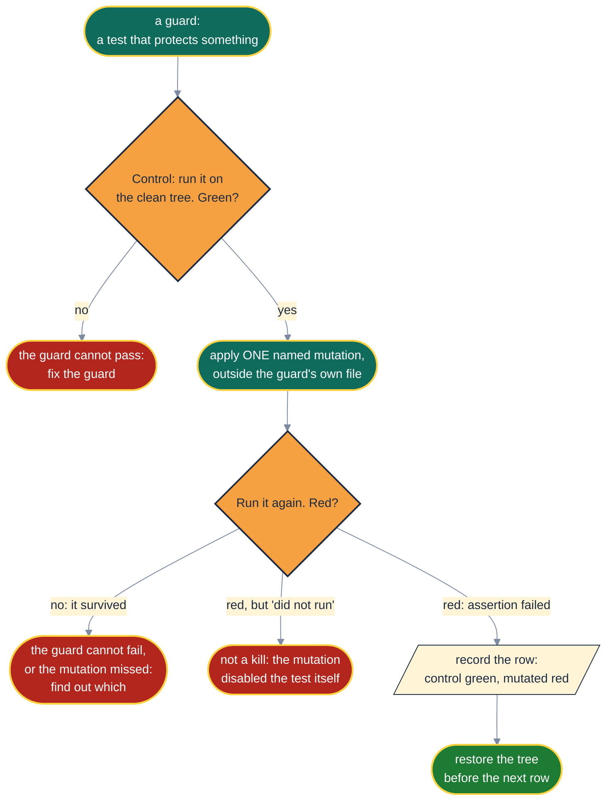

# 🎯 The Kill-Test Ledger: Guards, Gunned Down

> A test that has never failed is a rumour. A test you have watched fail, then pass, is evidence.

Every guard in this repo must be able to **fail** and must be able to **pass**. Failing means it goes
red under a named mutation applied outside the guard itself. Passing means it goes green on the
unmutated tree. A row needs both observations: one without the other is an uncontrolled experiment.

The idea is mutation testing's: judge a test suite by the faults it can detect
([DeMillo, Lipton & Sayward](sources.md#demillo-1978)). Coverage proves a line ran. A kill row proves
an assertion would notice if that line were wrong.

**How these were measured.**

- Rows 1 to 19 were first measured at the initial commit (v0.1.0) on Windows with Python 3.11,
  Spec Kit 1.3.0, Git Bash and PowerShell 7.
- Row 20 was found by CI.
- Rows 21 to 31 were added with the docs overhaul on 2026-11-05. In the same run, rows 1 to 18 and
  20 were re-measured and all held. Row 19 was re-measured on its own, because its test file was
  rewritten to add anchor checks.
- Rows 32 to 41 were added with the dogfood fixes on 2026-11-06. In the same run, rows 1 to 31
  were all re-measured and all held; row 20 was measured through its unit test for the flag.
  Rows 34, 38 and 41 drive the real Spec Kit.
- Rows 42 to 45 were added with proportional panels on 2026-11-06. In the same run, rows 1 to 41
  were all re-measured and all held.
- Rows 46 to 57 were added with the lane-contract fixes on 2026-11-06. In the same run, rows 1 to
  45 were all re-measured and all held.
- Rows 58 to 65 were added with the one-rule-one-place fixes on 2026-11-06. In the same run, rows 1
  to 57 were all re-measured and all held.
- Rows 66 to 99 were added with the citation verifier on 2026-11-06, each through a scripted
  harness that ran the control, applied the mutation, ran it again and restored the file from a
  byte copy, checking its hash. Rows 1 to 65 were not re-measured in that run; the full suite,
  e2e included, was green on the same tree.
- Rows 100 to 103 were added on 2026-11-06 with the review fixes to the verifier, through the same
  kind of harness: control green, mutation red, file restored byte-exact. Rows 1 to 99 were not
  re-measured in that run; the full suite was green on the same tree.
- Rows 104 and 105 were added on 2026-11-06 with the second round of review fixes, through the same
  harness. Row 70 was re-measured in that run, because its test lost a redundant assertion, and
  held. Rows 1 to 69 and 71 to 103 were not re-measured; the full suite was green on the same tree.
- Rows 106 to 120 were added on 2026-11-09 with the pre-publication fixes, through the same kind
  of harness. A mutated run counted as red only when pytest reported an assertion failure, not
  a collection error. Rows 1 to 105 were not re-measured; the full suite, e2e included, was
  green on the same tree.
- Rows 121 to 124 were added on 2026-11-10 when the workflows' actions were pinned to commits,
  through the same kind of harness. Each mutation edits a workflow file, never the test. Rows 1 to
  120 were not re-measured; the full suite was green on the same tree.
- Rows 125 to 132 were added on 2026-11-10 with the time-zone check, through the same kind of
  harness. Each mutation edits `tools/check_commit_timezone.py`, never a test. Rows 112 to 117 were
  not re-measured after their tests moved to the shared `tests/tools/git_history.py` helper, a
  change to how the tests build commits, not to what they assert; their ten tests stayed green.
- Rows 133 to 135 were added on 2026-11-10 with CODEOWNERS, through the same kind of harness. Each
  mutation edits `.github/CODEOWNERS`, never the test.
- Rows 136 to 142 were added on 2026-11-10 when CI started checking each push over only the
  commits it pushed, through the same kind of harness. Rows 136 to 140 edit
  `tools/commit_range.py`; rows 141 and 142 edit `ci.yml`. No mutation edits a test. Rows 1 to 135
  were not re-measured; the full suite was green on the same tree.
- Rows 143 to 149 were added on 2026-11-10 with the markdown board's Step 0 and the `AID-0` demo
  item, through the same kind of harness. Rows 143 to 147 edit `shared/board-adapters.md`; rows
  148 and 149 edit `templates/board.md`. No mutation edits a test. Rows 1 to 142 were not
  re-measured; the full suite was green on the same tree.
- Each mutation was applied alone, the guarding tests were run, and the tree was restored before
  the next row.

| # | Guard | Mutation (applied outside the guard) | Control | Mutated |
|---|---|---|---|---|
| 1 | `tests/test_no_pii.py::test_private_denylist_terms_are_absent` | a private denylist term appended to README.md | green | red |
| 2 | `tests/test_no_pii.py::test_no_real_looking_ticket_keys` | a made-up ticket key (`XYZ-` plus four digits) appended to README.md | green | red |
| 3 | `tests/test_no_pii.py::test_no_email_addresses` | a personal-domain email appended to the Draft stage | green | red |
| 4 | `tests/test_no_pii.py::test_no_home_directory_paths` | a Windows home-directory path appended to the Draft stage | green | red |
| 5 | `tests/pack/test_pack_contract.py::test_every_runtime_path_points_at_a_file_in_the_pack` | Draft references `.specify/extensions/aididit/shared/nope.md` | green | red |
| 6 | `tests/pack/test_pack_contract.py::test_every_command_token_resolves` | Draft uses an unknown `__SPECKIT_COMMAND_…__` token | green | red |
| 7 | `tests/pack/test_pack_contract.py::test_every_config_key_mentioned_exists_in_the_template` | Draft mentions an undefined `lanes.*` key | green | red |
| 8 | `tests/pack/test_pack_contract.py::test_every_command_file_in_the_pack_is_registered` | a new persona command file not added to `extension.yml` | green | red |
| 9 | `tests/pack/test_pack_contract.py::test_versions_agree_across_package_manifest_and_pyproject` | `extension.yml` version bumped alone | green | red |
| 10 | `tests/pack/test_pack_contract.py::test_each_command_is_well_formed` | an `allowed-tools` key added to Draft's frontmatter | green | red |
| 11 | `tests/features/install` | `specify init` skipped for a non-Spec Kit folder | green | red |
| 12 | `tests/features/install` | the existing-board check removed (board overwritten) | green | red |
| 13 | `tests/features/install` | `.specify/aididit/.gitignore` written without `lanes/` | green | red |
| 14 | `tests/features/install` | a failed `specify extension add` returns exit 0 | green | red |
| 15 | `tests/test_specify_locator.py` | the bundled `specify` next to the interpreter ignored | green | red |
| 16 | `tests/features/doctor` | git downgraded from required to optional | green | red |
| 17 | `tests/scripts -k bash` | `spawn-lane.sh` lane alphabet widened to upper case | green | red |
| 18 | `tests/scripts -k pwsh` | `spawn-lane.ps1` lane match made case-insensitive | green | red |
| 19 | `tests/test_doc_links.py::test_relative_links_resolve` | README link to `docs/walkthrough.md` renamed to a missing file | green | red |
| 20 | `tests/features/install` and `tests/e2e` run with no `claude` on PATH | `--ignore-agent-tools` absent from `specify init` (the shipped v0.1.0 tree, which failed CI) | green | red |
| 21 | `tests/test_diagrams.py::test_every_diagram_starts_with_the_house_init_line` | one diagram's `lineColor` nudged by one hex digit | green | red |
| 22 | `tests/test_diagrams.py::test_every_class_def_comes_from_the_house_palette` | one diagram's `stop` class recoloured by one hex digit | green | red |
| 23 | `tests/test_diagrams.py::test_every_class_a_diagram_uses_is_defined_in_it` | a panel node tagged `:::nope` | green | red |
| 24 | `tests/test_diagrams.py::test_no_diagram_paints_with_ad_hoc_styles` | a `style S fill:#000000` line added to a diagram | green | red |
| 25 | `tests/test_diagrams.py::test_every_diagram_is_a_flowchart` | a walkthrough diagram switched to `sequenceDiagram` | green | red |
| 26 | `tests/test_diagrams.py::test_house_text_is_readable_on_every_class` | the brand book's `ok` text turned green-on-green | green | red |
| 27 | `tests/test_diagrams.py::test_house_nodes_stand_out_on_every_github_theme` | the brand book's `link` outline set to its own fill colour | green | red |
| 28 | `tests/test_diagrams.py::test_house_lines_labels_and_groups_read_on_every_github_theme` | the brand book's `lineColor` faded to `#B0B8C4` | green | red |
| 29 | `tests/test_diagrams.py::test_every_stage_has_a_flow_in_the_stage_guide` | the Tidy heading in the stage guide renamed | green | red |
| 30 | `tests/test_doc_links.py::test_anchors_resolve` | a citation to `sources.md#no-such-source` | green | red |
| 31 | `tests/test_no_pii.py::test_no_email_addresses` | an email inside `docs/assets/banner.svg` | green | red |
| 32 | `tests/test_cli.py::test_everything_the_cli_prints_is_ascii` | the install message prints the dotted wordmark again | green | red |
| 33 | `tests/pack/test_pack_contract.py::test_no_command_claims_a_name_outside_the_packs_namespace` | `aliases: ["speckit.assemble"]` put back on Assemble | green | red |
| 34 | `tests/e2e/test_install_e2e.py::test_no_skill_is_created_outside_the_packs_namespace` | row 33's mutation, measured through a real install | green | red |
| 35 | `tests/pack/test_pack_contract.py::test_reference_files_name_commands_without_tokens` | the lane contract's link 1 written as a raw command token again | green | red |
| 36 | `tests/pack/test_pack_contract.py::test_every_canonical_command_name_is_a_real_command` | `/speckit.aididit.ideate` misspelt in the lifecycle guide | green | red |
| 37 | `tests/pack/test_pack_contract.py::test_spec_kit_renders_every_token_as_a_registered_command` | dogfood F-14's rename: `PR-PREP` changed to `PR_PREP` in Iterate | green | red |
| 38 | `tests/e2e/test_install_e2e.py::test_installed_guides_carry_no_raw_command_tokens` | row 35's mutation, measured through a real install | green | red |
| 39 | `tests/features/install/test_install.py::test_given_the_constitution_is_still_the_template_when_install_then_warns_to_write_it` | the template mark misspelt `[PROJECT NAME]` | green | red |
| 40 | `tests/features/install/test_install.py::test_given_a_written_constitution_when_install_then_no_constitution_warning` | the template check dropped, so any constitution warns | green | red |
| 41 | `tests/e2e/test_install_e2e.py::test_a_fresh_project_is_told_its_constitution_is_unwritten` | row 39's mutation, against the constitution `specify init` really writes | green | red |
| 42 | `tests/pack/test_proportional_panels.py::test_the_panel_guide_defines_each_proportionality_rule_exactly_once` | the `P5.` id dropped from its heading in the panel guide | green | red |
| 43 | `tests/pack/test_proportional_panels.py::test_every_pointer_to_a_rule_resolves` | Tidy's grooming step pointed at a rule `P6` that does not exist | green | red |
| 44 | `tests/pack/test_proportional_panels.py::test_every_panel_step_cites_the_rule_that_decides_it` | the `P3` citation removed from the retro's vet step | green | red |
| 45 | `tests/pack/test_proportional_panels.py::test_the_inline_runner_hands_off_the_contract_by_path` | the inline runner told to copy the lane contract into the prompt again | green | red |
| 46 | `tests/pack/test_contract_loops.py::test_the_contract_defines_each_term_in_the_section_its_pointers_name` | the merge check's definition renamed to `**Merge rule.**` | green | red |
| 47 | `tests/pack/test_contract_loops.py::test_every_pointer_to_a_contract_term_names_its_section` | Deliver's pointer to required checks changed from §7 to §6 | green | red |
| 48 | `tests/pack/test_contract_loops.py::test_every_traced_passage_points_at_the_term_that_closes_its_loop` | Investigate's pointer to the merge check removed | green | red |
| 49 | `tests/pack/test_contract_loops.py::test_pack_changes_go_upstream_and_project_files_go_to_a_claimed_lane` | upstream drafts sent to the handoff note instead of `upstream.md` | green | red |
| 50 | `tests/pack/test_contract_loops.py::test_no_rule_leaves_a_pack_change_to_a_later_lane` | the retro guide told again that a later lane applies a pack change | green | red |
| 51 | `tests/pack/test_contract_loops.py::test_the_merge_check_reads_the_host_not_the_message` | the merge check reads `mergeCommit` instead of `mergedAt` | green | red |
| 52 | `tests/pack/test_contract_loops.py::test_every_merged_message_goes_through_the_merge_check` | the lifecycle guide lets the human's "merged" start Investigate again | green | red |
| 53 | `tests/pack/test_contract_loops.py::test_merge_commit_sha_is_never_read_as_proof` | Investigate takes the merge SHA from `merge_commit_sha` | green | red |
| 54 | `tests/pack/test_contract_loops.py::test_every_clean_tree_gate_ignores_runtime_state` | Iterate's clean-tree gate stops ignoring runtime state | green | red |
| 55 | `tests/pack/test_contract_loops.py::test_lanes_never_commit_the_board_and_one_owner_does` | the contract lets lanes commit the board | green | red |
| 56 | `tests/pack/test_contract_loops.py::test_a_widening_is_checked_against_sibling_lanes_before_handoff` | the resume file's lane table drops allowed paths | green | red |
| 57 | `tests/pack/test_contract_loops.py::test_required_checks_are_never_an_empty_set` | an empty set of required checks treated as green | green | red |
| 58 | `tests/pack/test_one_rule_one_place.py::test_credential_shapes_are_listed_once` | the lane runner lists a credential shape (`AKIA`) of its own again | green | red |
| 59 | `tests/pack/test_one_rule_one_place.py::test_one_redaction_marker` | the secret rule redacts as `[REDACTED:<category>]` instead | green | red |
| 60 | `tests/pack/test_one_rule_one_place.py::test_the_secret_rule_redacts_first_and_refuses_only_when_that_fails` | the secret rule writes text that still matches after redaction | green | red |
| 61 | `tests/pack/test_one_rule_one_place.py::test_every_secret_scan_points_at_the_one_rule` | the board adapter scans by its own rule, not the secret scan | green | red |
| 62 | `tests/pack/test_one_rule_one_place.py::test_the_decision_record_carries_a_timestamp_not_a_date` | the decision record's `Recorded:` timestamp put back as a `Date:` | green | red |
| 63 | `tests/pack/test_one_rule_one_place.py::test_every_decision_recorder_points_at_the_one_format` | Ideate points at the panel guide for the decision-record format again | green | red |
| 64 | `tests/pack/test_one_rule_one_place.py::test_every_retro_commit_subject_has_the_one_shape` | Iterate's retro commit subject names the feature instead of the item | green | red |
| 65 | `tests/pack/test_one_rule_one_place.py::test_deliver_refreshes_the_body_by_pr_preps_rule` | Deliver refreshes the PR body after every commit again | green | red |
| 66 | `tests/scripts/test_verify_quote.py::test_every_quote_on_the_page_is_found` | the verifier's all-found branch reports MISSING | green | red |
| 67 | `tests/scripts/test_verify_quote.py::test_a_quote_that_is_not_on_the_page_is_missing` | the verifier reports every quote found | green | red |
| 68 | `tests/scripts/test_verify_quote.py::test_a_missed_positive_control_is_an_instrument_failure_even_when_quotes_match` | a missed positive control is not recorded as a failure | green | red |
| 69 | `tests/scripts/test_verify_quote.py::test_a_matched_negative_control_is_an_instrument_failure` | a matched negative control is not recorded as a failure | green | red |
| 70 | `tests/scripts/test_verify_quote.py::test_the_negative_control_is_fresh_nonsense_on_every_run` | the negative control is a fixed phrase | green | red |
| 71 | `tests/scripts/test_verify_quote.py::test_the_exit_codes_are_distinct_and_none_is_a_crash_code` | MISSING shares exit 1 with an uncaught Python exception | green | red |
| 72 | `tests/scripts/test_verify_quote.py::test_quotes_dashes_and_case_are_normalised` | the curly-quote and dash fold table is not applied | green | red |
| 73 | `tests/scripts/test_verify_quote.py::test_each_typographic_variant_folds_to_its_plain_form` | NFKC runs before the fold table, so a double prime becomes two primes | green | red |
| 74 | `tests/scripts/test_verify_quote.py::test_whitespace_is_normalised` | only runs of spaces collapse, not newlines or other whitespace | green | red |
| 75 | `tests/scripts/test_verify_quote.py::test_normalise_folds_every_variant_to_one_form` | leading and trailing whitespace kept | green | red |
| 76 | `tests/scripts/test_verify_quote.py::test_inline_markup_does_not_split_a_quote` | `em` treated as a block tag | green | red |
| 77 | `tests/scripts/test_verify_quote.py::test_block_tags_separate_words` | `p` dropped from the block tags | green | red |
| 78 | `tests/scripts/test_verify_quote.py::test_every_block_tag_separates_the_words_either_side` | `li` dropped from the block tags | green | red |
| 79 | `tests/scripts/test_verify_quote.py::test_an_inline_tag_joins_the_text_either_side` | `span` treated as a block tag | green | red |
| 80 | `tests/scripts/test_verify_quote.py::test_a_stray_closing_script_tag_does_not_hide_the_rest_of_the_page` | a stray closing tag drives the hidden depth negative | green | red |
| 81 | `tests/scripts/test_verify_quote.py::test_script_and_style_are_not_page_text` | `style` content counted as page text | green | red |
| 82 | `tests/scripts/test_verify_quote.py::test_a_json_ld_byline_counts_as_the_positive_control` | the control is matched against visible text only | green | red |
| 83 | `tests/scripts/test_verify_quote.py::test_a_control_written_with_an_entity_matches_the_decoded_text` | the control is matched against raw markup only | green | red |
| 84 | `tests/scripts/test_verify_quote.py::test_a_fetched_page_is_verified` | an `http://` source is read as a file path | green | red |
| 85 | `tests/scripts/test_verify_quote.py::test_the_served_charset_decodes_the_page` | the served charset is ignored | green | red |
| 86 | `tests/scripts/test_verify_quote.py::test_a_failed_fetch_is_an_instrument_failure_not_a_missing_quote` | `main` maps an unreadable source to MISSING | green | red |
| 87 | `tests/scripts/test_verify_quote.py::test_a_refused_connection_is_an_instrument_failure` | `main` maps an unreadable source to MISSING | green | red |
| 88 | `tests/scripts/test_verify_quote.py::test_an_unreadable_file_is_an_instrument_failure` | `main` maps an unreadable source to MISSING | green | red |
| 89 | `tests/scripts/test_verify_quote.py::test_a_pdf_is_an_instrument_failure_because_the_matcher_cannot_read_it` | a PDF is decoded as text | green | red |
| 90 | `tests/scripts/test_verify_quote.py::test_an_unexpected_crash_is_an_instrument_failure_never_missing` | only expected failures are caught, so a crash escapes `main` | green | red |
| 91 | `tests/scripts/test_verify_quote.py::test_a_quote_is_required` | `--quote` made optional | green | red |
| 92 | `tests/scripts/test_verify_quote.py::test_a_blank_phrase_is_a_usage_error_because_it_matches_every_page` | blank phrases accepted by both `--control` and `--quote` | green | red |
| 93 | `tests/scripts/test_verify_quote.py::test_a_real_process_returns_the_documented_exit_code[found]` | quotes printed as raw Unicode | green | red |
| 94 | `tests/scripts/test_verify_quote.py::test_a_real_process_returns_the_documented_exit_code[missing]` and `[instrument-failure]` | the script's entry point drops the exit code | green | red |
| 95 | `tests/pack/test_citation_verifier.py::test_the_panel_verifies_quotes_with_the_shipped_verifier` | the panel's section 3 shows a grep call instead of the verifier | green | red |
| 96 | `tests/pack/test_citation_verifier.py::test_a_non_verdict_exit_is_an_instrument_failure_wherever_the_panel_says_so` | the panel's section 7 failure row put back to its old wording | green | red |
| 97 | `tests/pack/test_citation_verifier.py::test_the_documented_exit_codes_match_the_script` | the script's MISSING code changes and the contract's does not | green | red |
| 98 | `tests/pack/test_citation_verifier.py::test_the_panel_guide_points_at_the_verifier_instead_of_restating_it` | the panel guide's Step 6 put back to its old wording | green | red |
| 99 | `tests/e2e/test_install_e2e.py::test_the_installed_citation_verifier_runs_where_the_panel_says_it_is` | the script shipped as `verify_quote.py` | green | red |
| 100 | `tests/scripts/test_verify_quote.py::test_a_control_found_only_in_markup_cannot_vouch_for_a_missing_quote` | a byline found only in a script's data lets a missing quote report MISSING | green | red |
| 101 | `tests/scripts/test_verify_quote.py::test_a_latin_1_label_decodes_as_windows_1252_the_way_browsers_read_it` | an `iso-8859-1` label decodes as Python's latin-1, not windows-1252 | green | red |
| 102 | `tests/scripts/test_verify_quote.py::test_a_charset_declared_in_the_page_decodes_a_file` | a charset declared in a `<meta>` tag is ignored | green | red |
| 103 | `tests/scripts/test_verify_quote.py::test_undecodable_bytes_cannot_vouch_for_a_missing_quote` | undecodable bytes in the page text let a missing quote report MISSING | green | red |
| 104 | `tests/pack/test_citation_verifier.py::test_a_missing_quote_under_passing_controls_is_a_verdict_however_many_are_missing` | the panel's section 7 row calls every quote missing an instrument failure again | green | red |
| 105 | `tests/pack/test_citation_verifier.py::test_a_missing_quote_under_passing_controls_is_a_verdict_however_many_are_missing` | section 3 calls a missing quote under passing controls a hypothesis, not a finding about the citation | green | red |
| 106 | `tests/tools/test_build_pack_zip.py::test_the_manifest_and_every_pack_file_sit_at_the_zip_root` | the zip nests the pack under an `aididit/` folder | green | red |
| 107 | `tests/tools/test_build_pack_zip.py::test_the_readme_and_licence_travel_with_the_pack` | the README and LICENSE are left out of the zip | green | red |
| 108 | `tests/tools/test_build_pack_zip.py::test_python_bytecode_never_ships` | the bytecode filter is removed, so `__pycache__` ships | green | red |
| 109 | `tests/tools/test_build_pack_zip.py::test_a_tag_that_disagrees_with_the_pack_version_builds_nothing` | a mismatched tag is reported but the zip is built anyway | green | red |
| 110 | `tests/tools/test_build_pack_zip.py::test_a_matching_tag_builds_the_zip_where_asked` | the tag's leading `v` is no longer stripped before comparing | green | red |
| 111 | `tests/e2e/test_install_e2e.py::test_spec_kit_installs_the_release_zip` | the zip nests the pack two folders deep, which the real Spec Kit rejects | green | red |
| 112 | `tests/tools/test_check_commit_identity.py::test_a_denylist_term_in_any_identity_field_is_a_leak` | the committer email is no longer compared | green | red |
| 113 | `tests/tools/test_check_commit_identity.py::test_a_denylist_term_in_any_identity_field_is_a_leak` | identity fields are compared without folding case | green | red |
| 114 | `tests/tools/test_check_commit_identity.py::test_a_leak_names_the_denylist_line_without_echoing_the_term` | a hit prints the matched term | green | red |
| 115 | `tests/tools/test_check_commit_identity.py::test_an_empty_denylist_refuses_to_pass` | an empty denylist passes | green | red |
| 116 | `tests/tools/test_check_commit_identity.py::test_only_commits_in_the_range_are_read` | the range is replaced by `--all` | green | red |
| 117 | `tests/tools/test_check_commit_identity.py::test_a_clean_history_passes_through_main` | a blank denylist line is treated as a term, which matches every field | green | red |
| 118 | `tests/pack/test_pack_contract.py::test_lane_workflow_asks_for_the_same_spec_kit_range_as_the_pack` | the lane workflow's Spec Kit range drops its `<2.0.0` cap | green | red |
| 119 | `tests/test_readme.py::test_the_quick_start_names_the_python_floor_before_the_install_command` | the README names Python 3.10 | green | red |
| 120 | `tests/test_no_pii.py::test_no_email_addresses` | the code of conduct names another address on the project's domain | green | red |
| 121 | `tests/test_ci_workflows.py::test_the_workflows_use_actions_at_all` | `release.yml` is renamed `release.yaml`, out of the guard's sight | green | red |
| 122 | `tests/test_ci_workflows.py::test_every_action_is_pinned_to_a_commit_with_its_release_named` | one `setup-uv` step goes back to the movable tag `@v10.3.3` | green | red |
| 123 | `tests/test_ci_workflows.py::test_every_action_is_pinned_to_a_commit_with_its_release_named` | one `setup-uv` step loses its `# v10.3.3` comment | green | red |
| 124 | `tests/test_ci_workflows.py::test_one_action_runs_the_same_commit_everywhere` | `release.yml` checks out with v6.1.0's commit while `ci.yml` uses v7.0.1's | green | red |
| 125 | `tests/tools/test_check_commit_timezone.py::test_a_project_date_with_a_local_offset_is_a_leak` | the committer date is no longer checked | green | red |
| 126 | `tests/tools/test_check_commit_timezone.py::test_project_commits_dated_in_utc_pass` | the offset is read as the whole raw date, so no project date is ever UTC | green | red |
| 127 | `tests/tools/test_check_commit_timezone.py::test_only_the_project_side_of_a_commit_is_held_to_utc` | a project address on either side holds both dates to UTC | green | red |
| 128 | `tests/tools/test_check_commit_timezone.py::test_a_contributor_keeps_their_own_time_zone` | every address counts as the project's | green | red |
| 129 | `tests/tools/test_check_commit_timezone.py::test_the_project_address_matches_in_any_letter_case` | the address is compared without folding case | green | red |
| 130 | `tests/tools/test_check_commit_timezone.py::test_a_hit_fails_without_printing_the_offset` | a hit prints the offset it found | green | red |
| 131 | `tests/tools/test_check_commit_timezone.py::test_a_clean_history_passes_through_main` | `main` fails even when nothing was found | green | red |
| 132 | `tests/tools/test_check_commit_timezone.py::test_only_commits_in_the_range_are_read` | the range is replaced by `--all` | green | red |
| 133 | `tests/test_codeowners.py::test_every_file_is_owned_by_the_maintainers_team` | the catch-all `*` rule becomes `/src/` | green | red |
| 134 | `tests/test_codeowners.py::test_every_owner_is_a_team_of_the_organization` | a person is added as an owner | green | red |
| 135 | `tests/test_codeowners.py::test_every_owner_is_a_team_of_the_organization` | an email address is added as an owner | green | red |
| 136 | `tests/tools/test_commit_range.py::test_a_pull_request_runs_from_its_base_to_its_head` | a pull request is checked from its head alone | green | red |
| 137 | `tests/tools/test_commit_range.py::test_a_push_runs_from_before_it_to_after_it` | a push is checked over all of `HEAD` again | green | red |
| 138 | `tests/tools/test_commit_range.py::test_a_push_that_creates_the_branch_runs_over_everything_it_reaches` | a push that creates the branch starts at the all-zeros commit | green | red |
| 139 | `tests/tools/test_commit_range.py::test_main_prints_the_range_of_the_event_file` | `main` ignores the event's last commit and prints a range ending at `HEAD` | green | red |
| 140 | `tests/tools/test_commit_range.py::test_a_commit_already_on_the_branch_is_not_judged_again` | a push is checked over everything its last commit reaches | green | red |
| 141 | `tests/test_ci_workflows.py::test_the_identity_job_checks_only_the_commits_the_event_brought` | the `identity` job goes back to setting its own range, `HEAD` on a push | green | red |
| 142 | `tests/test_ci_workflows.py::test_the_identity_job_checks_only_the_commits_the_event_brought` | the step that reads the range is removed | green | red |
| 143 | `tests/pack/test_board_setup.py::test_every_board_provider_states_its_step_0[markdown]` | the markdown provider's Step 0 is removed | green | red |
| 144 | `tests/pack/test_board_setup.py::test_every_board_provider_states_its_step_0[github]` | the github provider's Step 0 loses its label | green | red |
| 145 | `tests/pack/test_board_setup.py::test_every_board_provider_states_its_step_0[jira]` | the jira provider's Step 0 loses its label | green | red |
| 146 | `tests/pack/test_board_setup.py::test_the_markdown_step_0_seeds_a_missing_board_from_the_starter_template` | Step 0 copies from a template path that is not the starter board | green | red |
| 147 | `tests/pack/test_board_setup.py::test_the_markdown_step_0_seeds_a_missing_board_from_the_starter_template` | Step 0 no longer forbids overwriting an existing board | green | red |
| 148 | `tests/pack/test_board_setup.py::test_a_users_first_item_on_the_starter_board_is_aid_1` | the demo item goes back to `AID-1` | green | red |
| 149 | `tests/pack/test_board_setup.py::test_a_users_first_item_on_the_starter_board_is_aid_1` | a second demo item `AID-1` is added beside `AID-0` | green | red |
| 150 | `tests/test_repo_links.py::test_every_organisation_link_names_a_current_repository` | the package's Homepage goes back to the pre-rename repository name | green | red |
| 151 | `tests/test_repo_links.py::test_every_organisation_link_names_a_current_repository` | a link to an unknown repository is added to `CONTRIBUTING.md`, a file that never held one | green | red |
| 152 | `tests/test_security_workflow.py::test_the_secrets_job_reads_the_whole_history_and_fails_on_a_finding` | the secrets job checks out a shallow clone | green | red |
| 153 | `tests/test_security_workflow.py::test_the_secrets_job_reads_the_whole_history_and_fails_on_a_finding` | gitleaks runs without `--redact` | green | red |
| 154 | `tests/test_security_workflow.py::test_the_secrets_job_reads_the_whole_history_and_fails_on_a_finding` | gitleaks exits 0 on a finding | green | red |
| 155 | `tests/test_security_workflow.py::test_the_dependency_job_fails_on_a_high_or_critical_cve` | the gate ignores HIGH CVEs | green | red |
| 156 | `tests/test_security_workflow.py::test_the_dependency_job_fails_on_a_high_or_critical_cve` | the gate's Trivy run loses `--exit-code 1`, so it reports and passes | green | red |
| 157 | `tests/test_security_workflow.py::test_every_downloaded_scanner_is_pinned_and_checksum_verified` | Trivy is unpacked without its checksum check | green | red |
| 158 | `tests/test_security_workflow.py::test_every_downloaded_scanner_is_pinned_and_checksum_verified` | gitleaks floats to `latest` | green | red |
| 159 | `tests/test_security_workflow.py::test_every_downloaded_scanner_is_pinned_and_checksum_verified` | gitleaks is unpacked before its checksum is verified | green | red |
| 160 | `tests/test_security_workflow.py::test_the_scans_run_on_each_change_and_every_week` | the weekly schedule is removed | green | red |
| 161 | `tests/test_security_workflow.py::test_the_workflow_reads_only_except_where_it_uploads_results` | the workflow's default token can write contents | green | red |
| 162 | `tests/test_security_workflow.py::test_the_workflow_reads_only_except_where_it_uploads_results` | the secrets job also gets `actions: write` | green | red |
| 163 | `tests/test_security_workflow.py::test_dependabot_covers_every_package_manager_the_repository_uses` | Dependabot's `uv` entry is removed | green | red |
| 164 | `tests/test_release_workflow.py::test_the_zip_is_attested_after_it_is_built_and_before_it_is_published` | the attestation step is removed | green | red |
| 165 | `tests/test_release_workflow.py::test_the_zip_is_attested_after_it_is_built_and_before_it_is_published` | the attestation names every zip in `dist/` | green | red |
| 166 | `tests/test_release_workflow.py::test_the_zip_is_attested_after_it_is_built_and_before_it_is_published` | the release is published before the zip is attested | green | red |
| 167 | `tests/test_release_workflow.py::test_the_token_writes_only_what_the_release_needs` | the workflow's default token can write contents | green | red |
| 168 | `tests/test_release_workflow.py::test_the_token_writes_only_what_the_release_needs` | the job loses `id-token: write`, so it cannot sign | green | red |
| 169 | `tests/test_release_workflow.py::test_the_token_writes_only_what_the_release_needs` | the job loses `attestations: write`, so it cannot store the attestation | green | red |
| 170 | `tests/test_release_workflow.py::test_the_token_writes_only_what_the_release_needs` | the job also gets `packages: write` | green | red |
| 171 | `tests/test_ci_workflows.py::test_every_action_is_pinned_to_a_commit_with_its_release_named[release.yml:24]` | the attest action floats on its `v4` tag | green | red |
| 172 | `tests/test_diagrams.py::test_every_diagram_fits_the_github_column_without_shrinking[README.md#1]` | the README's lifecycle runs left to right again (2,080 px) | green | red |
| 173 | `tests/test_diagrams.py::test_every_diagram_fits_the_github_column_without_shrinking[docs/cli.md#4]` | one diagram's init line drops the 8 px padding (904 px) | green | red |
| 174 | `tests/test_diagrams.py::test_every_diagram_fits_the_github_column_without_shrinking[docs/lifecycle.md#3]` | the panel's four rulings go back onto one row (1,106 px) | green | red |
| 175 | `tests/test_diagrams.py::test_every_diagram_fits_the_github_column_without_shrinking[docs/stages.md#3]` | Mode B's four outcomes go back onto one row (1,002 px) | green | red |
| 176 | `tests/test_diagrams.py::test_every_diagram_fits_the_github_column_without_shrinking[docs/stages.md#7]` | Investigate's four verdicts go back onto one row (1,109 px) | green | red |
| 177 | `tests/test_diagrams.py::test_every_diagram_fits_the_github_column_without_shrinking[docs/panel.md#3]` | the triage staircase loses its aligned column (876 px) | green | red |
| 178 | `tests/test_diagrams.py::test_every_diagram_fits_the_github_column_without_shrinking[docs/panel.md#1]` | the four citation outcomes go back onto one row (879 px) | green | red |
| 179 | `tests/test_ci_workflows.py::test_one_test_leg_measures_every_diagram_and_cannot_skip` | the measuring step is deleted | green | red |
| 180 | `tests/test_ci_workflows.py::test_one_test_leg_measures_every_diagram_and_cannot_skip` | the measuring step no longer requires the measurement | green | red |
| 181 | `tests/test_ci_workflows.py::test_one_test_leg_measures_every_diagram_and_cannot_skip` | the measuring step runs without the `diagrams` group | green | red |
| 182 | `tests/test_ci_workflows.py::test_one_test_leg_measures_every_diagram_and_cannot_skip` | the measuring step moves to the Ubuntu leg | green | red |

## 📝 Notes on Specific Rows

**Row 20 was found by CI, not by a local run.** Every local run had `claude` on PATH, which hid
Spec Kit's agent-CLI check. The e2e suite is now also run locally with the agent's folder stripped
from PATH. That reproduced CI's "claude not found" before the fix, and passes after it. Since then
the install tests carry a unit test for the flag itself, and removing the flag from the installer
turns them red locally too.

**Rows 17 and 18 survived on their first two attempts.** Both times the mutation was wrong, not
the test. The first attempt edited the usage comment instead of the pattern. The second widened
only the first character class, while the test input carries an upper-case letter later in the id.
The rows above record the corrected mutations.

**Row 31 needed the scanner widened first.** Before this change the PII scan read only text
suffixes such as `.md` and `.py`, so an email inside the SVG banner would have survived. The fix
went in red first: a test asserting that the banner is scanned failed, then `.svg` joined the
scanned suffixes.

**Rows 26 to 28 mutate the brand book, not the tests.** The brand book's first diagram is the
single source of truth for the palette. Recolouring it to a failing contrast is exactly the change
a future contributor might make, and the measurement catches it.

**Rows 34, 38 and 41 repeat a unit row's mutation one layer out.** A mutation keyed on an in-process
detail can miss a subprocess, which is how the dogfood lane wrote a kill row that could never go
red. Each of these three mutates the pack or the installer, and then measures through a real
`specify` install.

**Row 37 keeps a rejected fix rejected.** The dogfood lane proposed renaming the hyphenated token,
because a token-shaped substitution might skip the hyphen. Spec Kit 1.3 keeps a hyphen inside its
segment, so the rename would have rendered `/speckit.aididit.pr.prep` for every markdown agent. The
test uses Spec Kit's own resolver as the oracle, so it moves if Spec Kit's rule ever does.

**Rows 86 to 88 mutate the verdict mapping, not the reader.** Any mutation inside the verifier's
source reader is caught twice over. A swallowed error leaves an empty page, which fails the
positive control; an unexpected exception falls into the crash net. Both still exit `4`, so those
mutations survive by design. The only way to report a bad source as MISSING is to change how
`main` maps failures to exit codes, so that is the mutation these three rows apply.

**Rows 125 to 132 also have a real-world control.** The check was run on two real commits with the
same tree: one dated with the maintainer's local offset, which it failed on both dates, and its
re-dated `+0000` copy, which it passed. The first was never merged and its branch is deleted.

**Row 140 is why rows 136 to 142 exist.** A merge made with GitHub's button put a maintainer's
profile name into `main` on 2026-11-10. The maintainer accepted it, but the push check read all of
`HEAD`, so every later push to `main` would have failed on that one commit. Checking each push over
`before..after` judges a commit once, when it lands. Row 140 replays that history in a throwaway
repository: the accepted commit fails a whole-history check and is not read by the next push's.

**Row 151 is why the test reads every tracked file.** The rename left the old name in four files,
and a list of those four would pass the next file to pick up a link. Before the fix the test was
seen red on all ten stale links, and both rows' mutations are applied outside the test.

**Rows 152 to 163 read the workflow, so the scanners were also run for real.** A test can show a
flag is there, not that the tool obeys it. On 2026-11-11 the exact CI command lines were run with
the pinned releases (gitleaks 8.30.1, Trivy 0.76.2, checksums verified). gitleaks exited 0 on a
clean throwaway repository and 1 once a commit added a random, never-issued `ghp_` token; the token
appeared in neither its log nor its SARIF. Trivy exited 1 on a lockfile pinning `requests==2.19.0`
(seven HIGH or CRITICAL findings, among them CVE-2018-18074), and 0 on this repository's `uv.lock`.
Row 160 first went red through a `KeyError`, not an assertion, so it did not count; the test now
asserts on the missing key.

**Rows 172 to 178 mutate the diagrams, never the test.** Each removes one thing the redraw added,
and the width in brackets is what the test then measured. Rows 174 to 178 also prove that every
`~~~` row split is needed: delete any one and its diagram no longer fits. The test was first seen
red on the diagrams as they were on `main`, where 21 of 34 were wider than the column. Rows 179 to
182 keep the measurement in CI. The skip guard itself was observed on 2026-11-11 without
Playwright installed: 35 skips without `AIDIDIT_REQUIRE_DIAGRAMS`, and 35 failures with it set to
`1`, which is what stops CI from passing a check it never ran.

**Row 73 is the bug the tests found.** The first version applied NFKC before folding quotes.
NFKC splits a double prime into two single primes, which then folded to `''` instead of `"`. The
per-character fold test went red, and the fix was to fold first.

## 🕳️ Not Covered by a Kill Row

- **The security workflow on GitHub.** Rows 152 to 163 read `security.yml`, and the local runs
  above exercise the scanners. That the jobs pass on a runner is read from this change's pull
  request run. The Security tab upload happens only on `main` and the weekly run; the first, on
  2026-11-11, recorded a gitleaks and a Trivy analysis with 0 results each. Whether both jobs block
  a merge depends on the `protect main` ruleset, which lives in GitHub's settings, not in this
  repository; on 2026-11-11 it was read through the API and requires both.
- **Dependabot.** Row 163 checks the config names both package managers, not that Dependabot opens
  pull requests. Its first run, on 2026-11-11 when the config merged, opened a grouped `uv` pull
  request (Spec Kit 1.3.2 and ruff) that passed every check.
- **A real attestation.** Rows 164 to 171 read `release.yml`; the attestation is signed only when a
  tag runs the workflow on GitHub. It was observed on v0.2.3, on 2026-11-11:
  `gh attestation verify aididit-v0.2.3.zip --repo RubberDuckEngineering/ai-did-it` exited 0 and
  named `release.yml@refs/tags/v0.2.3` as the signer. Two controls exited 1: the same zip with one
  byte appended, and v0.2.2's zip. Releases up to v0.2.2 were published before this step and have
  no attestation; each release is checked the same way. The pinned
  `actions/attest-build-provenance` v4.2.2 is a composite action that runs `actions/attest` v4.2.1,
  whose `action.yml` at its pinned commit was read as `node24` on 2026-11-11.

- **Diagrams as GitHub draws them.** Rows 172 to 178 measure each diagram with Mermaid 12.2.0
  and the settings read from GitHub's diagram viewer on 2026-11-11. On that date the test's widths
  matched github.com to the pixel for every diagram GitHub drew without shrinking. If GitHub
  upgrades Mermaid, the pin goes stale and the test can pass while GitHub crops again. The 838 px
  column is GitHub's page layout, measured at windows 1280 px and wider; a
  narrower window or a phone (about 346 px) still crops, and only GitHub can fix that.
- **The two workflows themselves.** `release.yml` and the `identity` job in `ci.yml` only run on
  GitHub. Rows 106 to 117 cover the tools they call. The secret was observed reaching the
  `identity` job on 2026-11-10, when it checked 1 commit and printed no term. Whether a tag push
  creates the release is observed on the first real tag.
- **The time-zone step in `ci.yml`.** Rows 125 to 132 cover the tool; that CI calls it, on the
  pull request's own range, is read from each run's `identity` job log, not from a kill row.
- **An agent obeying the markdown Step 0.** Rows 143 to 147 check what the adapter says, not
  that an agent reading it creates the board. The gap was found on 2026-11-10 by a headless run of
  all 14 commands on a `specify extension add` install of v0.2.0. On v0.2.1, installed the same
  way, a headless Assemble run created the board byte-identical to the starter template, found
  Ready empty and stopped without a commit. Each release is observed the same way.
- **What GitHub puts in the event.** Rows 136 to 142 check the range read from an event file and
  that the job reads it before either check. That GitHub's push event carries `before` and `after`
  as documented is read from the job's `checking <range>` line. A force-push whose `before` no
  longer exists in the clone makes `git log` fail, so the job goes red rather than skip; that path
  has not been observed.
- **Who the code owners are.** Rows 133 to 135 check that CODEOWNERS names a team, not that the
  team exists, has write access or holds only the maintainers. GitHub reports an unknown or
  unwritable owner on the repository's CODEOWNERS errors endpoint, which is read after each change.
- **What a pinned commit runs.** Rows 121 to 124 check that each action is pinned to a commit and
  named, not what that commit contains. The Node 24 runtime of both pins was read from each
  action's `action.yml` at the pinned commit on 2026-11-10. A future bump needs the same check by
  hand.
- **End-to-end install** (`tests/e2e`) drives the real Spec Kit, and only its green control was
  observed. Its failure modes come from Spec Kit's behaviour, which this repo cannot mutate.
- **The real detached spawn** (`test_bash_spawn_passes_the_prompt_as_one_untouched_argument`) runs
  only on POSIX, so it executes on the Linux and macOS CI legs, not on Windows. On Windows the
  PowerShell spawn path is covered by dry-run, validation and missing-binary tests only.
- **What GitHub actually renders.** The diagram tests measure the declared colours. The diagrams
  were also rendered with Mermaid 11 from jsDelivr on the three page colours and inspected
  visually on 2026-11-05. Which Mermaid version github.com uses at any moment is outside this
  repo's control, and that is `[Unverified]` here.
- **External links.** The URLs on [the sources page](sources.md) were checked once, by hand, on
  2026-11-05. Link rot is not a test, because a test that fails when someone else's server is down
  is not measuring this repo.
