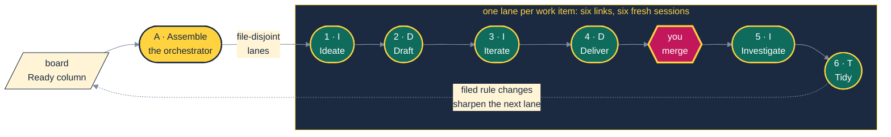
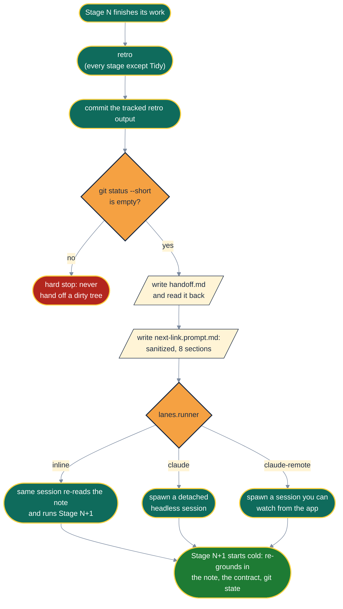
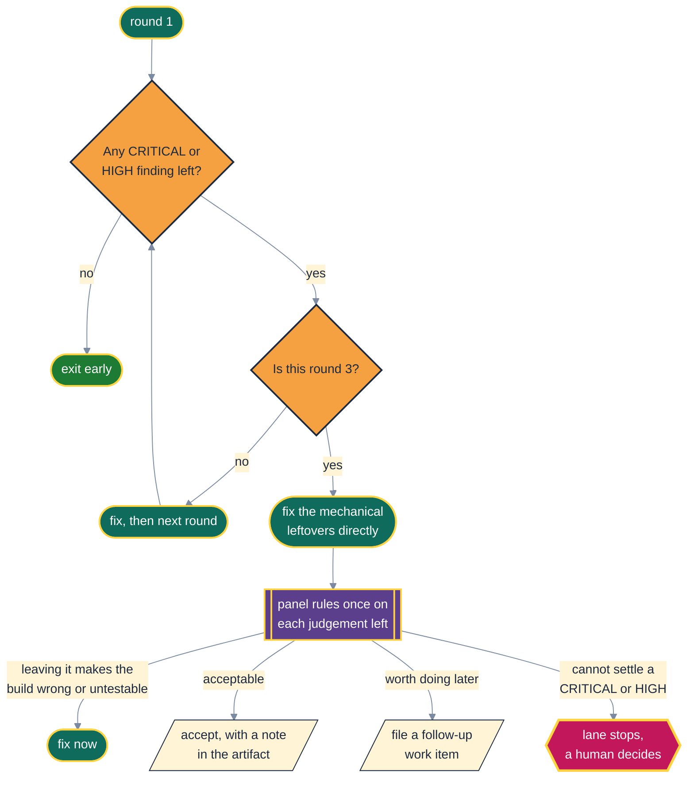
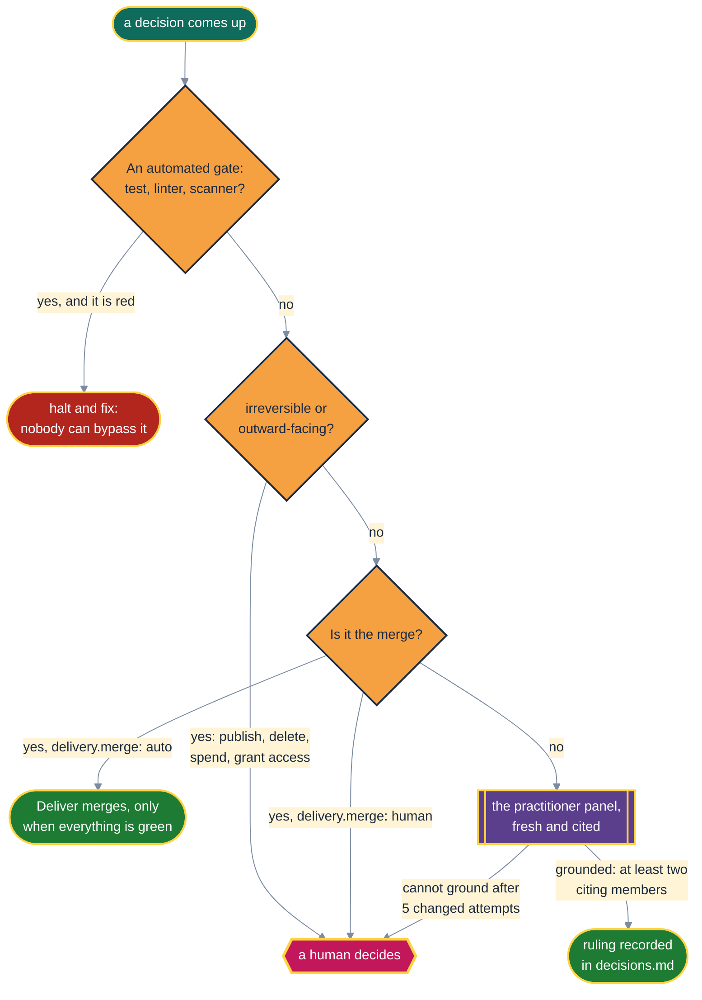
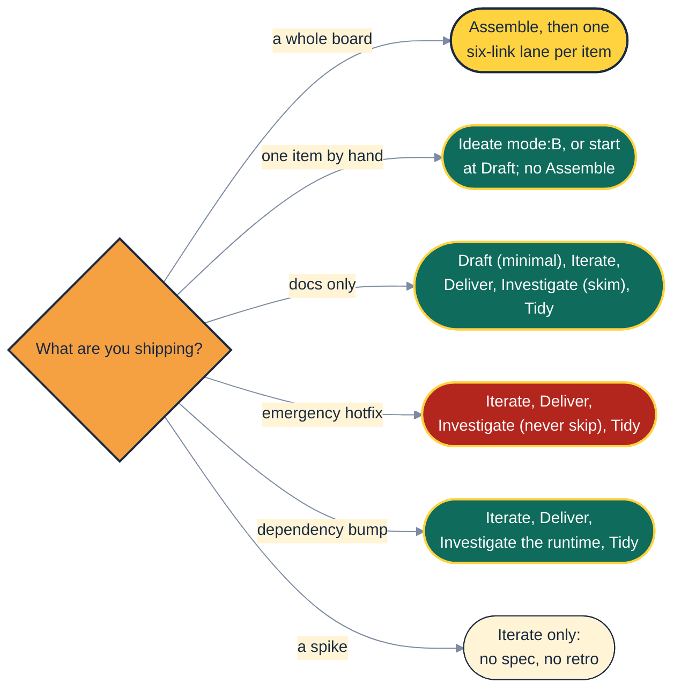

# 🔄 The Lifecycle, Lap by Lap

> Seven letters, six links, five practitioners, three rounds, one human gate. Somewhere a
> numerologist is very excited.

This page draws how the pieces connect: the lanes, the baton handed between links, the loops and
their budget, and who decides what. [The stage guide](stages.md) zooms into each stage. The
agent-facing contract is [`shared/lifecycle.md`](../src/aididit/pack/shared/lifecycle.md).

## 🏁 The Big Picture

Read the name as a sentence: *"A. I did it."* The claim of completion comes last, which is the only
honest place for it. Nothing is done until Tidy, and Tidy runs only after the merge and after
Investigate has checked the change against the running system.

Why this shape? It answers a problem the [Agile Manifesto](sources.md#agile-manifesto) never had
to consider: the developer forgets everything between sessions. XP's practices still apply, with
small releases, test first and continuous integration ([Beck & Andres](sources.md#beck-2004)). AI
Did It adds a written memory between sessions so those practices survive the forgetting.

## 🏃 The Baton: How One Link Hands to the Next

Every link ends the same way. The handoff note is on disk **before** the next link starts, so a
killed session never takes the lane's state with it.

"A summary adds to the window. A handoff subtracts from it." Long contexts degrade quietly
([Liu et al.](sources.md#liu-2024); [Hong, Troynikov & Huber](sources.md#hong-2025)). So each
boundary is a deliberate garbage-collection point: the next session gets a short note instead of the
whole history. [Board, Batons and Background Sessions](board-and-lanes.md) covers the runners in
detail.

## 🪢 Loops on a Leash

Most stage work happens in loops: clarify and analyze in Draft, red-green-refactor and
post-implementation analyze in Iterate, panel and bot rounds in Deliver. Every one of them runs
under the same budget.

**Why three rounds?** Findings per round fall fast, then flatten out at the reviewer's noise floor
`[Inference, from observed round counts such as 24 → 22 → 13]`. Wording-level findings do not change
what gets built, and Iterate's red-green cycle catches a spec mistake more cheaply than another
analyze round. It is a timebox, and it never lowers a quality bar: the panel chooses how to meet a
bar, never whether to.

## 🧑‍⚖️ Who Decides What

**Why the merge is the gate.** It is the last reversible moment. It is the one decision no
citation can settle ("do I want this in my trunk now?"). And it batches your attention: ten lanes
give you ten green PRs and one repeated question. Trunk-based teams keep the trunk releasable at
all times ([Humble & Farley](sources.md#humble-farley-2010)), so what enters it deserves a human's
judgement. Teams that have earned the trust can set `delivery.merge: auto`.

## 🧩 When Not Every Stage Applies

Investigate is the stage people are most tempted to skip, and the worst one to skip. The changes
made in a hurry are the ones whose collateral damage nobody looked for.

## 🥡 Takeaways

- `A` assembles the lanes; each lane runs `I-DID-IT`, one fresh session per link.
- The handoff note is on disk before the next link starts. A handoff subtracts context.
- Every loop is capped at three rounds; whatever is left gets one panel ruling.
- Automated gates cannot be overruled. Irreversible actions and the merge belong to a human.
- Skip Assemble for one item, never skip Investigate.
