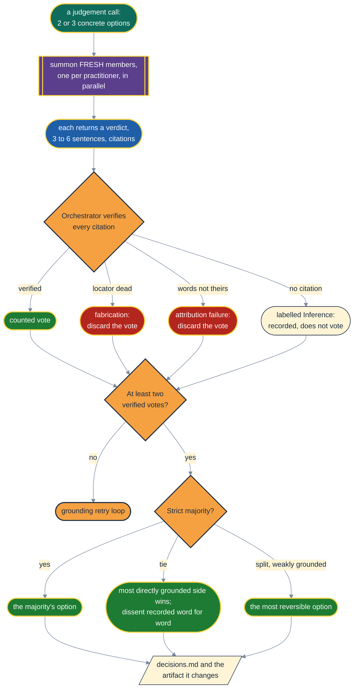
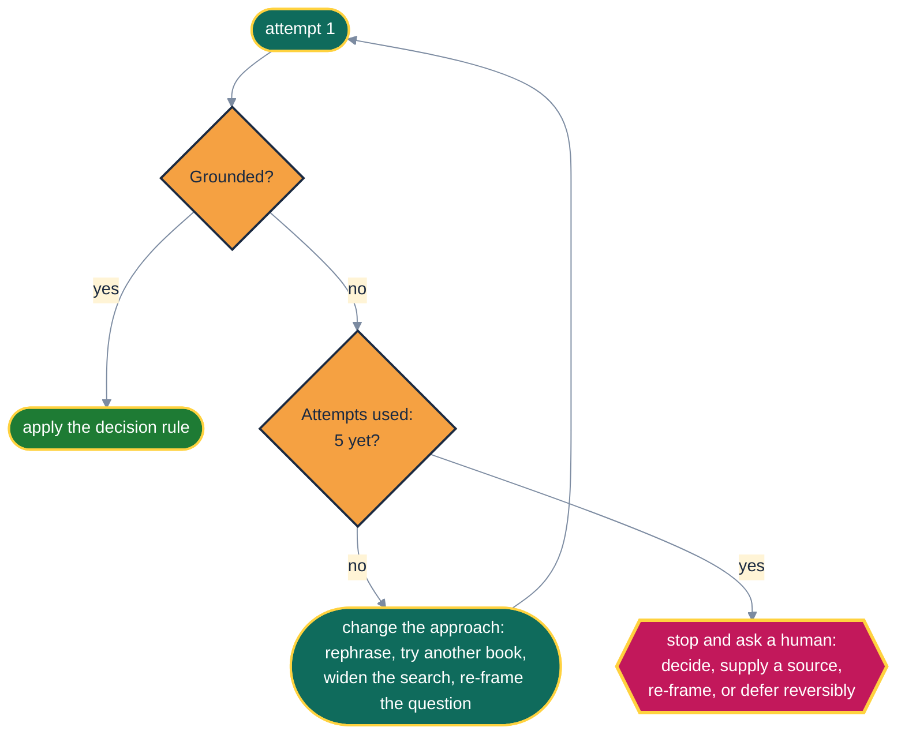
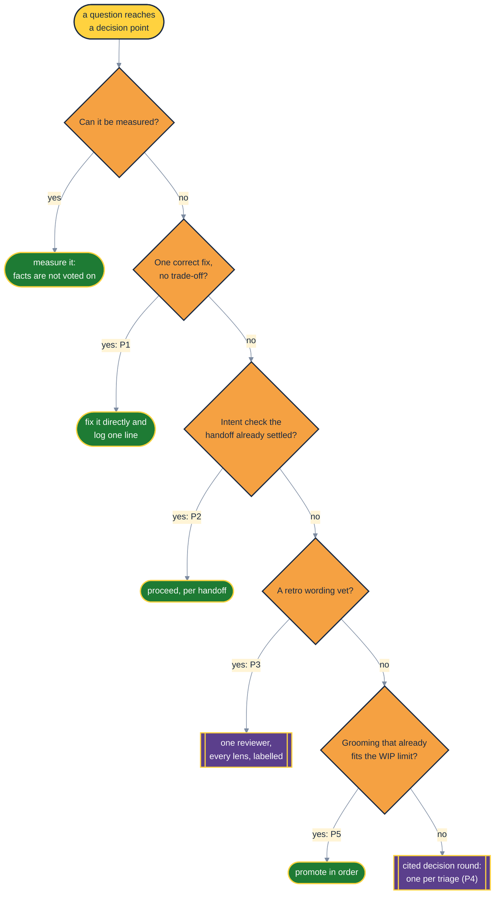

# ⚖️ The Panel: Proof, Please

> "In God we trust. All others must bring data." (Often credited to W. Edwards Deming, though nobody
> has found where he said it, which is a citation problem the panel would reject on sight.) The
> panel's version: every member brings a source, and the source has to resolve.

When a lane hits a judgement call, it does not page you. It convenes a **practitioner panel**:
one fresh persona per practitioner in `panel.practitioners`, each arguing from what that person
actually published, each with a citation the orchestrator checks. This page draws how a ruling
gets made. The agent-facing rules are in
[`shared/practitioner-panel.md`](../src/aididit/pack/shared/practitioner-panel.md) and
[`shared/panel-guide.md`](../src/aididit/pack/shared/panel-guide.md).

## 🪑 Who Sits on It

| Practitioner | Lens | Start reading |
|---|---|---|
| Kent Beck | TDD, YAGNI, the simplest thing that could work, tidying | [XP Explained](sources.md#beck-2004), [TDD by Example](sources.md#beck-2002), [Tidy First?](sources.md#beck-2023), [Test Desiderata](sources.md#beck-desiderata) |
| Martin Fowler | refactoring, evolutionary design, the economics of quality | [Refactoring](sources.md#fowler-2018), [Is quality worth the cost?](sources.md#fowler-quality), [Continuous Integration](sources.md#fowler-ci) |
| Dave Farley | continuous delivery, testability, empirical engineering | [Continuous Delivery](sources.md#humble-farley-2010), [Modern Software Engineering](sources.md#farley-2021) |
| Udi Dahan | service boundaries, messaging, autonomy | [Clarified CQRS](sources.md#dahan-cqrs) |
| Robert C. Martin | clean code, SOLID, boundaries | [Clean Code](sources.md#martin-2008), [The Clean Coder](sources.md#martin-2011), [Clean Architecture](sources.md#martin-2017) |

These are search seeds, not citations. A member must find, fetch and quote its source in the round
that uses it. A persona is a simulation of a published position, and nobody on this list has
reviewed or endorsed AI Did It.

## 🗳️ How a Ruling Gets Made

**Why fresh members every time?** A panel that remembered its earlier rulings would anchor on
them. An early number or verdict drags later judgements toward it
([Tversky & Kahneman](sources.md#tversky-kahneman-1974)). Members also never see each other's
positions before giving their own: a crowd's judgement is only wise when its members judge
independently ([Surowiecki](sources.md#surowiecki-2004)).

**Why authentic voices?** If two members' positions could swap names without anyone noticing, the
panel has collapsed into one reviewer wearing several badges. Beck's spare, question-led style
should not read like Martin's principle-named one.

## 🔬 Checking a Quote: One Instrument, Two Controls

A resolving URL is not a verified quote, so the orchestrator checks every quoted string against the
page with the pack's own verifier, `scripts/verify-quote.py`. It is plain standard-library Python, so
it behaves the same on Windows, macOS and Linux. Each run checks two controls: the page's byline must
be found, and a fresh nonsense phrase must not be. The verifier exits `0` when every quote is found,
`3` when one is missing, and `4` when the instrument itself failed.

The two controls exist because an instrument can fail in a way that looks like a result. In a
dogfood run, `grep` on Windows Git Bash aborted on minified HTML. The check read the abort as "no
match" and marked every quote missing. A failed control, or any exit other than `0` or `3`, means the
check measured nothing, and no vote is discarded on its word. The exact call is in section 3 of the
pack's `practitioner-panel.md`.

## 🔁 When Nobody Can Cite: the Grounding Retry Loop

Repeating a failing search five times is one attempt made five times, so each retry has to change
something. With no web access at all there is nothing to retry: the panel escalates at once. The
alternative, a verdict built from remembered citations, is worse than no verdict. It enters the spec,
the ADR and the code with the same authority as a real one, and it looks just as rigorous.

## 💸 Proportional Panels: Spend the Seats Where They Count

A panel member is a fresh sub-agent, and its bill is set by the context it loads, not by the size of
its question. In a dogfood run, every member cost about the same whether it ruled on a design fork
or on a typo. Intent checks ran in four stages and never changed a plan, and retro wording vets
cost five members per stage. So the pack now asks, before every round, whether the round could change
anything. The rules live once, in the pack's `panel-guide.md` Part 0, and every stage cites the
one it obeys.

When a case only nearly meets a rule, the panel convenes. The rules drop rounds that cannot change
an outcome, never rounds that might. This is the lean idea of removing waste, not value: work that
adds nothing the customer would pay for is the first thing to cut
([Poppendieck & Poppendieck](sources.md#poppendieck-2003)).

## 🚫 What the Panel Can Never Decide

- **Whether to meet a quality bar.** Test first, coverage, killable assertions and required checks
  are not up for a vote. The panel decides only how to meet them.
- **Anything irreversible or outward-facing.** Publishing, deleting, spending money and changing
  access stay with a human.
- **The merge**, unless `delivery.merge: auto` is set.
- **Facts.** The panel rules between options; it cannot audit the premises it was handed. A
  measured fact beats a unanimous vote.

## 🥡 Takeaways

- No citation, no vote; fewer than two verified votes, no ruling.
- Fresh, independent members every round, so no anchoring and no echo chamber.
- Five changed attempts, then a human. Never a fabricated fallback.
- The panel picks how, never whether.
- Proportional: no seat for a fact, a typo, a settled intent or a set that already fits.
