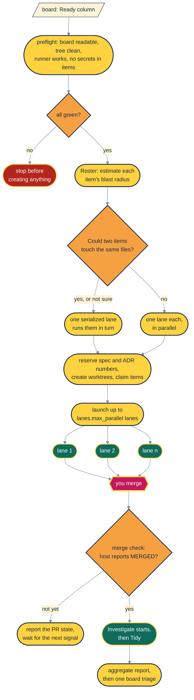
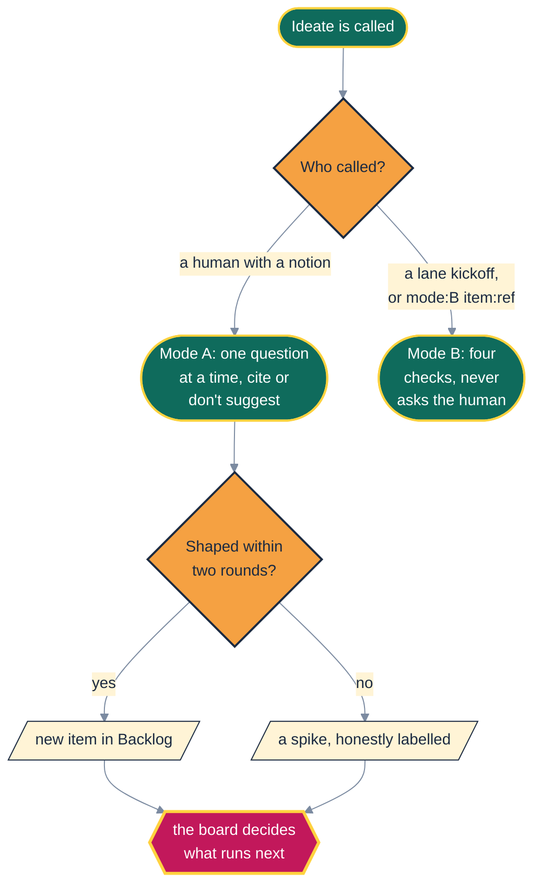
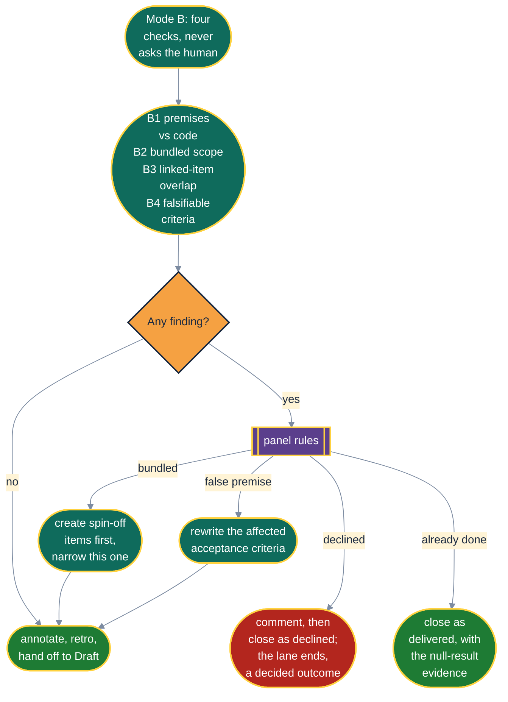
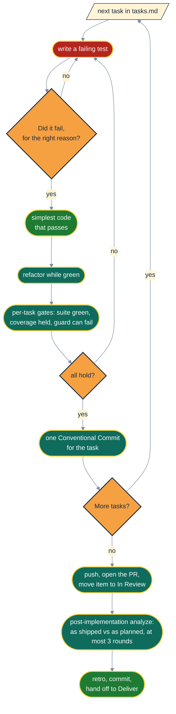
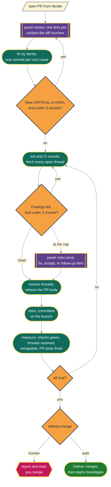
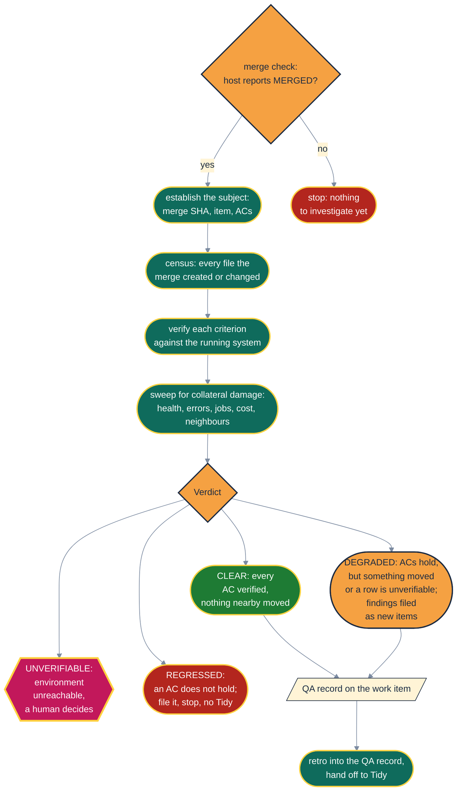
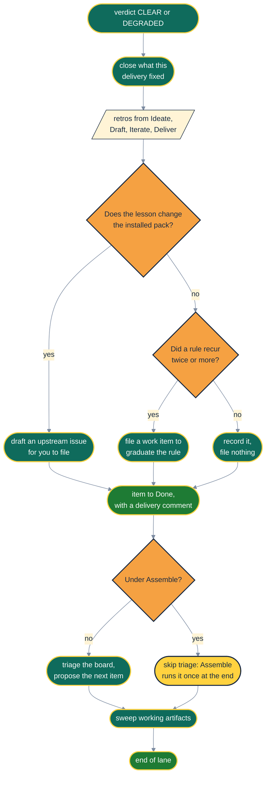

# 🧭 Seven Stages, Seen

> A lane is a relay race. The baton is a file, the runners have no memory, and nobody is allowed to
> run two legs in a row.

This page draws every stage as a flow. Each section starts with what the stage is for and the
published practice it borrows. It ends with where the stage hands off. The agent-facing contracts
live in [`shared/lifecycle.md`](../src/aididit/pack/shared/lifecycle.md) and the stage command
files; when a diagram here and a command file disagree, the command file wins.
[The brand book](brand.md) explains the colours and shapes.

| Stage | Lane link | Mood | Ends at |
|---|---|---|---|
| [Assemble](#-assemble-air-traffic-for-agents) | orchestrator | orchestration | a report and a groomed board |
| [Ideate](#-ideate-interrogate-the-idea) | 1 | discovery or review | a well-formed item, or a cited decline |
| [Draft](#-draft-deliberate-dont-dash) | 2 | deliberation | `spec.md`, `plan.md`, `tasks.md`, ADRs |
| [Iterate](#-iterate-red-green-refactor-repeat) | 3 | producer | an open PR |
| [Deliver](#-deliver-defend-the-diff) | 4 | reviewer | a green PR, every thread resolved |
| [Investigate](#-investigate-guilty-until-proven-shipped) | 5 | verification | a verdict |
| [Tidy](#-tidy-turn-takeaways-into-tickets) | 6 | reflection-action | `Done`, and new work filed |

---

## 🅰️ Assemble: Air Traffic for Agents

**What it is for.** Assemble turns a board into running work. It does not write any code itself.
It decides which items may run side by side, starts each one as a lane, and keeps score.

**What it borrows.** Lanes are sized and grouped by blast radius. That follows the small-batch,
deployment-pipeline thinking in *Continuous Delivery* ([Humble & Farley](sources.md#humble-farley-2010))
and the queueing economics of [Reinertsen](sources.md#reinertsen-2009). Items that might touch the same
files share one lane and run one after another. Adding parallel workers to tangled work mostly
adds coordination cost, a point [Brooks](sources.md#brooks-1975) made about people decades before
it applied to agents.

**Why "uncertain means serialize".** The two possible mistakes cost very different amounts.
Serializing two items that could have run in parallel costs some waiting. Running two overlapping
items in parallel costs a merge conflict, and two agents each confidently undoing the other's work.

**Full Auto Mode.** With `delivery.merge: auto` the human merge gate moves into each lane's Deliver
link. Each Deliver merges its own PR once every required check is green and every thread is
resolved. Assemble then keeps a pool loop watching every lane. The orchestrator itself still never
merges anything, and a `REGRESSED` verdict still stops the lane.

**Hands off to:** link 1 of each lane, `ideate mode:B`.

---

## 💡 Ideate: Interrogate the Idea

**What it is for.** Ideate catches a bad work item before Draft spends a whole session on it. The
caller picks one of two modes, and the stage announces which mode it is in on its first line of
output. Getting the mode wrong fails silently either way: a lane that waits for a human who is not
there, or a raw notion turned into requirements nobody asked for.

**What it borrows.** Mode A is the Planning Game conversation from *Extreme Programming Explained*
([Beck & Andres](sources.md#beck-2004)): challenge the premise, then shape the story, then size it.
Stories are checked against INVEST ([Wake](sources.md#wake-2003)). Asking why repeatedly comes from
[Ohno](sources.md#ohno-1988). Mode B's falsifiability check is [Popper](sources.md#popper-1959)
applied to acceptance criteria: a criterion that cannot fail cannot pass.

Mode B runs its four checks in order, and the panel rules on anything they find:

**Mode B never halts the lane.** Every finding goes to [the panel](panel.md). The lane continues,
or ends with a cited decision. A decline counts as a successful outcome, not a failure: the panel
just saved a whole lane's worth of effort.

**Create before cite.** When an item is split, the new items are created first. Their real ids are
read back from the board, and only then written into the original item. An id is never forecast
("it'll probably be AID-43"), because an id that turns out wrong points somewhere real.

**Hands off to:** Draft (Mode B), or nothing (Mode A, a decline, or already done).

---

## 📝 Draft: Deliberate, Don't Dash

**What it is for.** Draft turns an accepted item into the artifact set every later stage works
from: `spec.md`, `plan.md`, `tasks.md`, contracts and decision records. It runs Spec Kit's own
commands, wrapped in two loops with a fixed budget and a team review.

**What it borrows.** Writing the spec first is Spec Kit's premise ([Spec Kit](sources.md#spec-driven)).
Draft-and-revise in small steps follows [Fowler](sources.md#fowler-2018). Each architectural choice is
written down as a lightweight decision record ([Nygard](sources.md#nygard-2011)). The team review
puts the business, development and testing views on the same story before any code exists, which
is the Three Amigos practice ([Agile Alliance](sources.md#three-amigos)) with two more chairs added.

```mermaid
%%{init: {"theme": "base", "themeVariables": {"fontSize": "15px", "primaryColor": "#FFF4D6", "primaryTextColor": "#1B2A41", "primaryBorderColor": "#1B2A41", "textColor": "#1B2A41", "lineColor": "#7C8BA1", "edgeLabelBackground": "#FFF4D6", "clusterBkg": "#1B2A41", "clusterBorder": "#FFD23F", "titleColor": "#FFD23F"}, "flowchart": {"diagramPadding": 8}}}%%
flowchart TB
    BASE(["git baseline: clean tree,<br/>on the latest default branch"]):::link --> G0{"baseline ok?"}:::gate
    G0 -->|"no"| X(["hard halt"]):::stop
    G0 -->|"yes"| SP(["specify"]):::link --> CL(["clarify round"]):::link
    CL --> CQ[["panel answers each question,<br/>answer recorded in spec.md"]]:::panel
    CQ --> CB{"CRITICAL or HIGH left,<br/>and under 3 rounds?"}:::gate
    CB -->|"yes"| CL
    CB -->|"no"| PL(["plan"]):::link --> TK(["tasks"]):::link --> AN(["analyze round"]):::link
    AN --> KIND{"finding kind?"}:::gate
    KIND -->|"mechanical:<br/>drift, placeholder"| MF(["fix it, no gate"]):::link
    KIND -->|"judgement:<br/>ambiguity, contradiction"| AP[["panel picks one of<br/>2 or 3 resolutions"]]:::panel
    MF --> AB{"CRITICAL or HIGH left,<br/>and under 3 rounds?"}:::gate
    AP --> AB
    AB -->|"yes"| AN
    AB -->|"no"| TR(["team review, one round:<br/>PO, Architect, QA, DevSec, DevOps"]):::persona
    TR --> OUT[/"spec.md, plan.md, tasks.md,<br/>contracts, ADRs"/]:::note
    OUT --> HO(["retro, commit,<br/>hand off to Iterate"]):::ok
    classDef link fill:#0F6B5C,color:#FFFFFF,stroke:#FFD23F,stroke-width:2px
    classDef gate fill:#F5A142,color:#1B2A41,stroke:#1B2A41,stroke-width:2px
    classDef panel fill:#5B3F8C,color:#FFFFFF,stroke:#FFD23F,stroke-width:2px
    classDef stop fill:#B3261E,color:#FFFFFF,stroke:#FFD23F,stroke-width:2px
    classDef ok fill:#1E7B34,color:#FFFFFF,stroke:#FFD23F,stroke-width:2px
    classDef note fill:#FFF4D6,color:#1B2A41,stroke:#1B2A41,stroke-width:1px
    classDef persona fill:#1F5FA8,color:#FFFFFF,stroke:#FFD23F,stroke-width:2px
```

**Never skip a step on a small item.** The analyze loop is what catches drift, and "this feels
unnecessary" is exactly when drift gets in. A small item just has a short loop.

**Hands off to:** Iterate.

---

## 🔁 Iterate: Red, Green, Refactor, Repeat

**What it is for.** Iterate builds what Draft specified, one task at a time, test first. It stops
when the pull request is open and the post-implementation analyze loop has closed.

**What it borrows.** Red-green-refactor and watching the test fail first come from
[Beck](sources.md#beck-2002). The refactor step follows [Fowler](sources.md#fowler-2018). One
Conventional Commit per task follows the [Conventional Commits spec](sources.md#conventional-commits).
The "every guard must be able to fail" rule is mutation testing's founding idea: a test suite is
judged by the faults it detects ([DeMillo, Lipton & Sayward](sources.md#demillo-1978)).

**Producer, then reviewer.** Iterate writes the code and Deliver judges it, in separate sessions.
Splitting the two at the PR boundary means nobody has to remember to switch mindset under time
pressure: the stage boundary does it for them.

**Hands off to:** Deliver.

---

## 🚚 Deliver: Defend the Diff

**What it is for.** Deliver takes the PR from open to green and defensible. It runs a panel review
of the diff, works through every bot finding, and resolves every thread. Then it stops: by
default the merge is yours.

**What it borrows.** Done means releasable, not merely pushed, as in *Continuous Delivery*
([Humble & Farley](sources.md#humble-farley-2010)). Keep the build green and fix a red build first
([Fowler](sources.md#fowler-ci)). Review comments use [Conventional Comments](sources.md#conventional-comments)
so a reader can tell blocking from non-blocking at a glance.

**Fix by family, not by finding.** Before each fix commit, Deliver fetches every open thread and
fixes everything that shares a root cause in one commit. Fixing one instance per round just brings
the same finding back next round.

**Reviewers never approve.** Panel reviewers post Conventional Comments and nothing else. They never
approve a PR or request changes; approval belongs to a human.

**Hands off to:** Investigate, once the PR has merged.

---

## 🔍 Investigate: Guilty Until Proven Shipped

**What it is for.** Investigate checks the merged change against the running system and tries to
prove it failed. It reports success only when that attempt fails. It files what it finds
rather than fixing it, because a verification stage that fixes things ends up grading its own work.

**What it borrows.** Every earlier gate checks the work against itself: specs against specs, code
against its own tests, the PR against its own stated intent. Testing can show the presence of bugs
but never their absence ([Dijkstra](sources.md#dijkstra-1970)). So this stage starts from the
opposite assumption, that the delivery failed, and looks for evidence against it
([Popper](sources.md#popper-1959)). Findings are written up blamelessly, the way SRE postmortems are
([Google SRE](sources.md#sre-postmortem)).

**The host says merged, not the chat.** A "merged" message is a cue to ask the git host, never the
trigger itself. Investigate starts only when the host reports the PR `MERGED` with a merge time.
GitHub's `merge_commit_sha` is no proof: it is set on an open PR too, for the test merge GitHub
builds ([GitHub](sources.md#github-pulls-api)).

**Absence of a signal is not a pass.** An empty error log on a service that is not logging is not
evidence that everything is fine. A `CLEAR` verdict with an `UNVERIFIABLE` row is a contradiction;
that combination is `DEGRADED`.

**Silent is not the same as absent.** Some signals a system does not have at all: a command-line
tool has no deploy target, no long-running process and no scheduler. Investigate records such a
row as `absent (verified: <how>)`, naming the check that proved it, and files nothing. A signal
that exists but shows no data for the window is still a finding about observability.

**Hands off to:** Tidy on `CLEAR` or `DEGRADED`; a human otherwise.

---

## 🧹 Tidy: Turn Takeaways into Tickets

**What it is for.** Tidy carries out what the retros decided. It closes the item, triages the board,
and files a work item for every lesson that should change how the project works. It never edits
those rules itself: the lane claimed for that item makes the change through its full lifecycle,
like any other change. A lesson about the pack itself goes upstream instead. The pack's files in
your project are installed copies that the next install overwrites, so Tidy drafts the issue in the
lane folder and you file it in the pack's own repository.

**What it borrows.** A retro is worth its actions ([Derby & Larsen](sources.md#derby-larsen-2006)),
and learning only sticks once you act on it, the "act" step of Plan-Do-Study-Act
([Deming](sources.md#deming-1986)). The stage is named after Beck's habit of small, separate
tidyings ([Beck](sources.md#beck-2023)) and the Boy Scout Rule of leaving the code cleaner than you
found it ([Martin](sources.md#martin-2008)).

**No retro on Tidy.** A retro on Tidy could only ask "did we act on the retro?", which is an audit,
and auditing the audit never ends. The state the lane leaves behind is the audit: either the rules
were filed or they weren't, the board matches reality or it doesn't, and a retro can't change
that.

**Hands off to:** nobody. That's the lane done.
