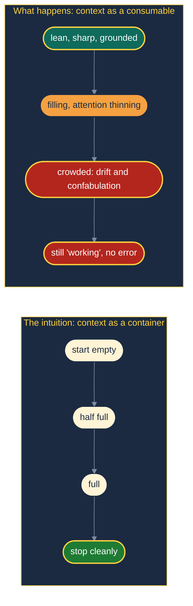
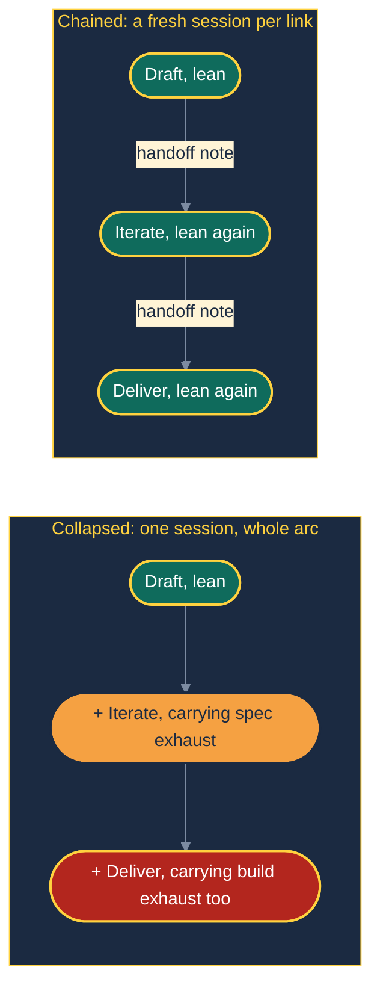
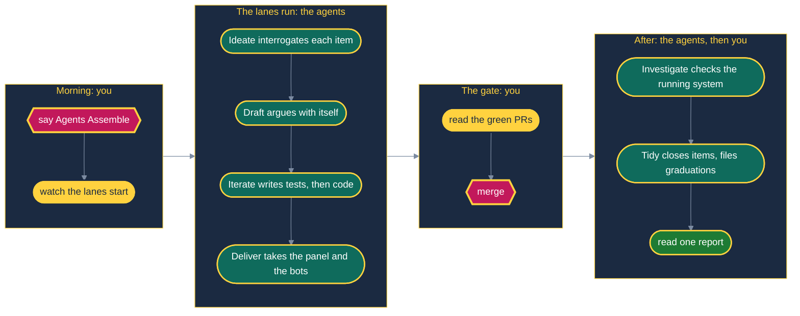

# 🗺️ The Whole System, Walked Through

> "The workflow shape is the memory-management strategy. Every other property follows from that one decision."

This page explains what the A·I·DID·IT lifecycle is, why it has the shape it has, and how the parts fit, in one read. It is written for people: the files the agent reads at runtime live under [`src/aididit/pack/`](../src/aididit/pack/), and the stage-by-stage contract is [`lifecycle.md`](../src/aididit/pack/shared/lifecycle.md).

**Read this if** you are new, if you are about to adopt the pack in a repository, or if you want to know why a system this autonomous still stops at exactly one place.

---

## 🌊 The Problem: Drowning in Exhaust

> "An agent does not fail by running out of room. It fails by drowning in its own exhaust."

The obvious way to use a coding agent is one long session: here is the feature, work through it. That fails in a specific, repeatable way, and not the way people expect.

The intuition is that an agent works well until its context is full, then stops. That is wrong twice:

1. **Quality degrades long before capacity runs out.** Models use information in the middle of a long context less reliably than information at its start or end ([Liu et al.](sources.md#liu-2024)), and measured performance drops as input length grows, well inside the advertised window ([Hong, Troynikov & Huber](sources.md#hong-2025)). There is no truncation, no error and no signal that anything changed. `[Inference]` A long agent session suffers the same way, because its own tool output is that long input.
2. **Most of what accumulates is spent fuel.** Tool output, API responses, superseded plans, review transcripts. All of it was needed once; little of it is needed now, and all of it competes with what is.

A two-stroke engine needs a scavenging stroke to clear burnt fuel as much as it needs an intake stroke. A session with no scavenging stroke runs rougher every cycle while the gauge still reads "running".

So the lifecycle is a **context-budget decision**, not ceremony. Each stage boundary is a garbage-collection point, placed where the ratio of spent to useful context is worst: where the most can be dropped for the least loss.

---

## 🔤 The Name Is the Map

**A·I·DID·IT**: seven letters, seven stages, in order.

| | Stage | One line |
|---|---|---|
| **A** | Assemble | Read the board, carve lanes, launch them |
| **I** | Ideate | Interrogate the work item before a context window is spent on it |
| **D** | Draft | Specify, clarify, plan, tasks, analyze |
| **I** | Iterate | Implement test-first, commit, push, open the PR, re-analyze |
| **D** | Deliver | Panel and bot review, drive every check green, stop |
| **I** | Investigate | Verify the merged change against the running system |
| **T** | Tidy | Close the work item, triage the board, graduate what was learned |

**`A` assembles the lanes; each lane runs `I-DID-IT`.** Six links, one per letter after the A. Assemble orchestrates and delivers nothing itself; a thing cannot be one of the things it drives. Assemble is also optional: shipping a single item by hand, you start the lane at Ideate.

Read as a sentence, *"A. I did it."* puts the claim of completion at the very end, which is the only honest place for it. Nothing is done until Tidy, and Tidy runs only after the merge and after Investigate confirmed reality agreed.

---

## 💡 Ideate: Two Modes, Chosen by the Caller

| Mode | Invoked by | Nature | Role |
|---|---|---|---|
| **A: Discover** | a human, directly | conversational, Socratic, one question at a time | Before the board. Turns a raw notion into a work item. Not a lane link |
| **B: Review** | Assemble's lane kickoff | autonomous, panel-decided, never asks the human | Lane link 1. Interrogates an accepted item before Draft spends a window on it |

The **caller** picks the mode, never a heuristic reading the input. A misdetected mode fails silently in both directions: Mode A inside a lane waits forever for a human who is not watching; Mode B on a raw notion invents requirements for an item that does not exist. A lane kickoff always carries the lane contract and a work-item key, and a human at a prompt carries neither. The stage announces its mode in its first line of output, so a misdetection is visible immediately.

Mode B runs four checks, each aimed at a recurring failure:

| Check | Question | What it catches |
|---|---|---|
| B1 premises vs code | Is every claim about current state true? | An item built on a false premise wastes the whole lane |
| B2 bundled scope | Two or more separable deliverables? | A task list that outruns one context window |
| B3 linked-item overlap | Do blocking or blocked items overlap these criteria? | Overlap found at PR review is found too late |
| B4 falsifiable criteria | Can each acceptance criterion fail? | A criterion that cannot fail cannot pass |

**Mode B never halts the lane.** A bundled item gets split by the panel: the spun-off items are created, the current one is narrowed, the decision is recorded, and Draft starts. If the panel declines the item outright, the lane ends cleanly at Ideate. A bad item costs one session instead of six, and that is the whole reason Ideate became link 1.

---

## 🧼 One Stage, One Session

> "A summary adds to the window. A handoff subtracts from it."

**Each link ends by starting the next as a fresh session.** An agent should not run two links in one continuous session, however much room seems to be left.

- **"Enough context left" is the wrong question.** The boundary exists to shed context, not because the window is exhausted.
- **Autonomy is a property of the chain, not of one session.** Each link finishes and starts the next without asking anyone.
- **A session nobody can see is a session nobody can steer.** Each link writes its handoff note to disk before the next starts, so a killed session never takes state with it, and each link is visible as a session or a log.

How the next link starts depends on the runner you configure ([`lane-runner.md`](../src/aididit/pack/shared/lane-runner.md)). `claude` and `claude-remote` start a genuinely fresh session per link. `inline`, the default, works with every agent but runs the next stage in the same session: it keeps the persisted note and the discipline, and gives up the context reset. If your agent can start sessions, prefer a spawning runner.

---

## 🔗 A Lane, Link by Link

```mermaid
%%{init: {"theme": "base", "themeVariables": {"fontSize": "15px", "primaryColor": "#FFF4D6", "primaryTextColor": "#1B2A41", "primaryBorderColor": "#1B2A41", "textColor": "#1B2A41", "lineColor": "#7C8BA1", "edgeLabelBackground": "#FFF4D6", "clusterBkg": "#1B2A41", "clusterBorder": "#FFD23F", "titleColor": "#FFD23F"}}}%%
flowchart LR
    B[/"board item, reserved numbers,<br/>lane contract"/]:::note --> L1(["1 Ideate<br/>premises, scope,<br/>overlap, falsifiable ACs"]):::link
    L1 -->|"handoff,<br/>never halts"| L2(["2 Draft<br/>specify, clarify, plan,<br/>tasks, analyze"]):::link
    L2 -->|"handoff"| L3(["3 Iterate<br/>red, green, refactor,<br/>commit, PR, analyze"]):::link
    L3 -->|"handoff"| L4(["4 Deliver<br/>panel, bots, CI, retro"]):::link
    L4 -->|"PR green,<br/>not merged"| H{{"you merge"}}:::human
    H --> L5(["5 Investigate<br/>verify against the<br/>running system"]):::link
    L5 -->|"only if the<br/>verdict permits"| L6(["6 Tidy<br/>Done, delivery comment,<br/>graduations"]):::link
    classDef link fill:#0F6B5C,color:#FFFFFF,stroke:#FFD23F,stroke-width:2px
    classDef human fill:#C2185B,color:#FFFFFF,stroke:#FFD23F,stroke-width:3px
    classDef note fill:#FFF4D6,color:#1B2A41,stroke:#1B2A41,stroke-width:1px
```

Links 1 to 4 start each other. Links 5 and 6 start after the merge. [The stage guide](stages.md) draws each link's own flow.

Investigate ends with one of four verdicts. `CLEAR`: every criterion verified by direct evidence and nothing adjacent moved. `DEGRADED`: criteria hold but something moved or a criterion could not be verified; findings become new work items and Tidy proceeds. `UNVERIFIABLE`: the environment could not be reached; a human decides. `REGRESSED`: a criterion does not hold in the real environment. That is a **safety terminal**: the lane stops and does not tidy, because closing the item would record a success that did not happen.

---

## 🚪 Why the Merge Is the Gate

> "Autonomy is not the absence of judgement; it is the relocation of judgement to somewhere it can be audited."

A workflow that pauses at every judgement call is a slow pair-programming session. A workflow that never pauses is not trustworthy. The merge is the gate for three reasons:

1. **It is the last reversible moment.** Before it, everything is on a branch nobody depends on. Continuous delivery keeps the trunk releasable at all times ([Humble & Farley](sources.md#humble-farley-2010)), so what enters the trunk is the decision that matters.
2. **It is the one decision no citation settles.** Design forks and scope calls have literature behind them. "Do I want this in my trunk now?" is about intent and appetite.
3. **It batches attention.** Ten lanes overnight give a human ten green PRs and one repeated question, not a hundred interruptions.

Teams that have earned the trust can set `delivery.merge: auto` (Full Auto Mode): Deliver merges once every required check is green and every thread is resolved, in every runner mode, then starts Investigate. If the repository marks no check as required, every check that ran on the PR head counts, so an unprotected branch never passes by default. Deliver is the only merge owner; the orchestrator never merges. Under `human`, Deliver stops; the orchestrator starts Investigate when it sees the merge or you say "merged <item-ref>" (running stages by hand, you start Investigate yourself). Investigate starts Tidy. `REGRESSED` still stops the lane in every mode.

---

## ⚖️ Where Decisions Go: the Panel

> "A verdict that cannot name its source is an opinion wearing a verdict's clothing."

Everything else is decided by a **practitioner panel**: personas grounded in published practitioners (by default Kent Beck, Martin Fowler, Dave Farley, Udi Dahan and Robert C. Martin), each required to cite a real, locatable source.

- **No citation, no decision.** A persona that cannot cite returns `ABSTAIN`. Fewer than two citing personas means no verdict; after a grounding retry loop the panel stops and asks the human. There is no fallback to remembered citations, so the panel fails loudly instead of convincingly.
- **Fresh every time.** A panel that persisted would anchor on its own earlier rulings ([Tversky & Kahneman](sources.md#tversky-kahneman-1974)). Independent judgements aggregate well; judgements that copy each other just repeat the first mistake ([Surowiecki](sources.md#surowiecki-2004)).
- **How, never whether.** The panel chooses how to meet a quality bar, never whether to: test first, coverage, killable assertions, no skipped tests, measured rather than assumed green.

Every panel decision lands in the artifact it affects and in a per-feature decisions ledger, so a human can audit autonomous choices with one file. Details: [the panel guide](panel.md) and [`practitioner-panel.md`](../src/aididit/pack/shared/practitioner-panel.md).

---

## 🔁 The Loops, and Their Leash

> "A pipeline moves work forward. A loop moves work upward."

The stage list looks linear; the work is mostly loops.

- **Clarify and analyze, in Draft.** Mechanical findings (number drift, path drift, placeholders) are fixed without ceremony. Judgement findings go to the panel with two or three concrete resolutions.
- **Red, green, refactor, in Iterate.** The step people skip is watching the test fail; a test never seen red is of unknown value. The step that compounds is the refactor.
- **Panel, bots, fix, re-check, in Deliver.** Fix by family, not by finding: fetch every open thread first and fix everything sharing a root cause in one commit, or each round surfaces the next instance of the same mistake.
- **Loop until dry, for discovery.** When you do not know how many of something exist, run finders until several consecutive rounds return nothing new, deduplicating against everything seen (not only what was confirmed).

**Every review loop has a budget: three rounds.** It exits early once no critical or high finding remains. Mechanical leftovers are fixed on the spot, and each judgement left gets one panel ruling (fix now, accept with a note, or file a follow-up). Findings per round fall fast and then flatten onto the reviewer's noise floor, and red-green catches a spec mistake more cheaply than a seventh analyze pass.

Two loops sit outside sessions. **The session chain** is the only one that subtracts context. **The outer loop**, Tidy graduating lessons into the project's rules, has no termination predicate, correctly: it is the loop the system exists to run.

---

## 🪞 Retros, and the One Exception

Ideate (Mode B), Draft, Iterate, Deliver and Investigate each close with a retro, unconditionally, in the blameless tradition of [Kerth](sources.md#kerth-2001). A retro that can be declined gets declined exactly when it was needed. Retro analyses run as sub-agents where possible: their output is a short report, and loading their instructions into an already-crowded late-session window costs far more than the report is worth.

**Tidy runs no retro, by design.** Its work is the retro action set. A retro on Tidy would ask "did we act on the retro actions?", which is an audit with one input, and it would recurse. The audit already exists: rules graduated or did not, artifacts were swept or were not, the board reflects reality or does not. You cannot write a state assertion green.

Deliver's retro is the last that can ride the PR. Tidy-bound lessons from Investigate travel as text in the handoff note, because after the merge there is no branch to commit them to.

---

## 🛣️ Lanes in Parallel

> "Concurrency safety is a property of structure, not of care."

Assemble reads the board's `Ready` column, groups items that touch overlapping files, and runs disjoint groups concurrently (up to `lanes.max_parallel`). The cap is a work-in-progress limit in the Kanban sense ([Anderson](sources.md#anderson-2010)): by Little's law, fewer items in flight means each one finishes sooner ([Little](sources.md#little-1961)).

- **One worktree and branch per lane.** A lane never touches a sibling's worktree, branch or spec directory.
- **Stage by explicit path, never `git add -A`.** Siblings share an object store.
- **Numbers are reserved, then re-derived.** Local enumeration undercounts, because siblings hold reservations on their own branches.
- **Merge the default branch, then re-run everything** before opening the PR and before declaring green.
- **Transient infrastructure failures get re-run, not "fixed".**
- **Uncertainty serializes.** A wrongly serialized pair costs time; a wrongly parallelized pair costs a conflict.

---

## ☕ The Human's Day

The human's time is batched (one trigger, one review pass, one report) and spent where their judgement cannot be replaced: what to build, and what to trust into the trunk.

A lane's autonomous run ends when the PR is pushed with every required check green, every thread resolved, the PR body current, the retro committed, and the work item still `In Review`. It moves to `Done` only in Tidy, after the merge and after Investigate.

---

## 📖 Vocabulary Map

| A·I·DID·IT term | Spec Kit term | Agile / XP term |
|---|---|---|
| Assemble | `speckit.aididit.assemble` (orchestrates lanes; no core equivalent) | Kanban pull from a WIP-limited queue; iteration planning |
| Ideate, Mode A | `speckit.aididit.ideate` (precedes `speckit.specify`) | Story writing, the Planning Game, on-site customer |
| Ideate, Mode B | `speckit.aididit.ideate mode:B item:<item-ref>` | Backlog refinement, Definition of Ready, Three Amigos |
| Draft | `speckit.aididit.draft`, wrapping `specify`, `clarify`, `plan`, `tasks`, `analyze` | Story refinement, acceptance criteria, design session |
| Iterate | `speckit.aididit.iterate`, wrapping `implement` and a post-implementation `analyze` | TDD, continuous integration, small releases |
| Deliver | `speckit.aididit.deliver` with `speckit.aididit.pr-review` | Code review, deployment pipeline, Definition of Done |
| Investigate | `speckit.aididit.investigate` (no core equivalent) | Acceptance verification in production, exploratory testing |
| Tidy | `speckit.aididit.tidy`, filing constitution changes as work items | Acting on retrospective actions, the Boy Scout Rule, *Tidy First?* |
| Lane | a feature branch plus its `specs/<NNN-feature>/` directory | A story in flight |
| Link | one stage command run in one session | One focused working session |
| Work item | the input to `speckit.specify` | User story or task |
| `Ready` column | (board, outside Spec Kit) | Selected for development |
| Practitioner panel | (no core equivalent) | Architecture review, on-site expertise |
| Decisions ledger | `specs/<NNN-feature>/decisions.md` | Decision log, lightweight ADRs |
| Loop budget | `loops.*_max_rounds` in `aididit-config.yml` | Timeboxing |
| Merge gate | `delivery.merge: human` | Human approval before release |
| Full Auto Mode | `delivery.merge: auto` | Continuous deployment |

---

## 🧭 Where to Go Next

| You want | Read |
|---|---|
| Every stage drawn as a flow | [the stage guide](stages.md) |
| How lanes, links and loops fit together | [the lifecycle guide](lifecycle.md) |
| Each stage's contract, the gate matrix, the portability contract | [`lifecycle.md`](../src/aididit/pack/shared/lifecycle.md) |
| The rules every lane runs under | [`lane-contract.md`](../src/aididit/pack/shared/lane-contract.md) |
| How the next link starts in each runner mode | [`lane-runner.md`](../src/aididit/pack/shared/lane-runner.md) |
| How work items are read and moved per provider | [`board-adapters.md`](../src/aididit/pack/shared/board-adapters.md) |
| Panel summoning and decision rules | [`practitioner-panel.md`](../src/aididit/pack/shared/practitioner-panel.md) |
| The engineering disciplines the stages apply | [`tdd.md`](../src/aididit/pack/shared/disciplines/tdd.md), [`bdd.md`](../src/aididit/pack/shared/disciplines/bdd.md), [`clean-code.md`](../src/aididit/pack/shared/disciplines/clean-code.md), [`conventional-commits.md`](../src/aididit/pack/shared/disciplines/conventional-commits.md), [`prompt-crafting.md`](../src/aididit/pack/shared/disciplines/prompt-crafting.md) |

Where this page and a pack file disagree, the pack file wins.

---

## 🥡 Takeaways

- The shape is a context strategy. Stage boundaries are garbage-collection points.
- `A` assembles the lanes; each lane runs `I-DID-IT`, one link per letter.
- Ideate's mode is chosen by the caller; Mode B never halts the lane.
- A handoff subtracts from the window; a summary adds to it.
- No citation, no decision. The panel chooses how, never whether.
- Loops carry a three-round budget; the session chain is the one loop that subtracts.
- Five stages retro; Tidy does not, because the post-Tidy state is the stronger check.
- The merge is the gate because it is the last reversible moment, and `REGRESSED` stops the lane in every mode.
