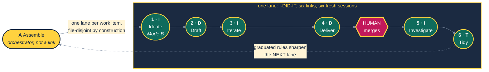
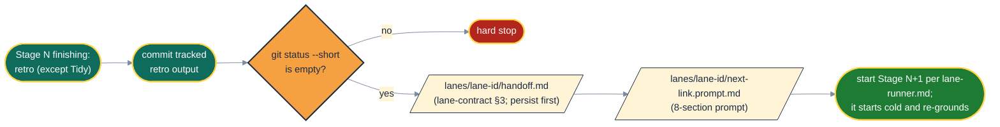

# A·I·DID·IT Lifecycle: The Stage Reference

> "Assemble the lanes. Ideate the work. Draft the bet. Iterate to build it. Deliver it to users. Investigate what actually happened. Tidy what you learned."

Every change runs through seven stages: **A**ssemble, **I**deate, **D**raft, **I**terate, **D**eliver, **I**nvestigate, **T**idy. Each stage is a compound command: it runs several inner steps, closes with a retro where one applies, and hands off to the next stage.

**The mnemonic is the map: `A` assembles the lanes; each lane runs `I-DID-IT`.** Six links, one per letter after the A. Assemble is the only non-link, because a thing cannot be one of the things it drives.

This file is the reference for each stage's contract, the transition contract, the standing rules, the decision-gate matrix and the portability contract. Where it disagrees with a stage command file or with `.specify/extensions/aididit/shared/lane-contract.md`, those win.

---

## The Seven Stages

| | Stage | Command | Lane link | Mood | What the agent does | Citation |
|---|---|---|---|---|---|---|
| **A** | Assemble | `/speckit.aididit.assemble` | orchestrator | Orchestration | read the board, group by file overlap, reserve numbers, carve lanes, launch, report | **Farley**: batch size and blast radius; the deployment-pipeline framing of *Continuous Delivery* `[lens]` |
| **I** | Ideate | `/speckit.aididit.ideate` | 1 | Discovery (A) / Review (B) | **Mode A:** Socratic conversation, challenge the premise, shape the work item. **Mode B:** interrogate premises, scope, overlap and testability of an accepted item | **Beck**: the Planning Game and on-site-customer conversation in *Extreme Programming Explained* `[lens]` |
| **D** | Draft | `/speckit.aididit.draft` | 2 | Deliberation | specify, clarify, plan, tasks, analyze | **Fowler**: writing-craft authoring; the draft-and-revise aesthetic of *Refactoring* |
| **I** | Iterate | `/speckit.aididit.iterate` | 3 | Producer | implement (TDD), commits, push, open PR, post-implementation analyze | **Beck / XP**: iteration as the primary unit of work in *Extreme Programming Explained* |
| **D** | Deliver | `/speckit.aididit.deliver` | 4 | Reviewer | practitioner panel, bot review rounds, resolve threads, PR green, then stop for the merge | **Farley**: *Continuous Delivery*; deliver value to users, not just code to trunk |
| **I** | Investigate | `/speckit.aididit.investigate` | 5 | Verification | verify the merged change against the running system, sweep for collateral damage, file findings | **Martin**: professional responsibility for what you ship, *The Clean Coder* `[lens]` |
| **T** | Tidy | `/speckit.aididit.tidy` | 6 | Reflection-action | work item to Done, delivery comment, board triage, rule graduations, artifact sweep | **Beck** (*Tidy First?*) and **Martin** (the Boy Scout Rule) |



Eight citations across seven stages: Beck three times, Farley twice, Fowler and Martin once each. Count the column rather than trusting this sentence. The default panel (`panel.practitioners` in `.specify/extensions/aididit/aididit-config.yml`) also includes Udi Dahan, who is consulted on boundary and service-autonomy decisions rather than owning a stage.

> **Citation honesty.** Citations marked `[lens]` name each practitioner's documented position rather than quoting a verified passage, and they have not been through panel grounding. Treat them as `[Inference]` until a panel round confirms or replaces them. The unmarked citations were grounded when the stage names were first chosen.

### Why Ideate and Investigate exist

**Ideate** closes two gaps. Mode A closes the *authoring* gap: something has to write the work item, and an unnamed conversation has no rules. Mode B closes the *acceptance* gap: a well-written item can still be wrong to hand to Draft, because it rests on a premise the code already contradicts, bundles two efforts, overlaps a linked item, or carries acceptance criteria that cannot fail.

**Investigate** exists because every gate before it is self-referential. Draft's analyze loop checks artifacts against each other. Iterate's tests check code against tests. Deliver's panel and bots check the change against its own stated intent. A green pipeline proves the written tests passed; it does not prove the work item was satisfied, and it says nothing about what moved next door.

---

## Stage Contracts

### A: Assemble (orchestrator)

Turns a board into running work. Phases, in order:

| Phase | What it does |
|---|---|
| Preflight | Fail fast. Worktrees, branches and reserved numbers outlive an aborted run, so every check happens before anything is created |
| Roster | Read the `Ready` column through the board adapter; group items by file overlap. **Uncertainty serializes**: a wrongly serialized pair costs wall-clock, a wrongly parallelized pair costs a conflict |
| Number reservation | Pre-assign spec directory and decision-record numbers per lane, and require each lane to re-derive before finalizing, because local enumeration undercounts sibling reservations |
| Launch | Start one lane per group, up to `lanes.max_parallel`, each carrying the lane contract inline |
| Report | One structured per-lane report |

No retro: its lessons surface inside the lanes. Skip Assemble when shipping a single item by hand; below two concurrent lanes it is ceremony.

### I: Ideate (link 1)

**The caller selects the mode, never a heuristic.** A lane kickoff carries the inlined contract and a work-item key, so it is always Mode B. A human typing a notion gets Mode A. A human (or the single-lane workflow) may force Mode B with `mode:B item:<item-ref>`. The stage announces its detected mode in the first line of output, because a misdetection fails silently in both directions: Mode A inside a lane stalls forever waiting for a human who is not watching, and Mode B on a raw notion invents requirements for an item that does not exist.

**Mode A (Discover)** is conversational and pre-board. One question at a time; challenge the premise rather than elaborate it; label every claim `[Verified]`, `[Inference]` or `[Unverified]`; never fabricate a citation; the default answer is "not yet". Two rounds maximum. If the idea is still shapeless, the honest output is a spike. Mode A reports the work item, what was decided and rejected, and does not start Draft: what runs next is the board's call.

**Mode B (Review)** is autonomous and never asks the human. Four checks:

| Check | Question | Failure it catches |
|---|---|---|
| B1 premises vs code | Is every claim about current state true? Grep for it | An item built on a false premise wastes the whole lane |
| B2 bundled scope | Two or more separable deliverables? | A bundled item produces a task list that outruns one context window |
| B3 linked-item overlap | Do `blocks` / `blocked by` items overlap these ACs? | Overlap belongs in the spec, not in PR review |
| B4 falsifiable ACs | Can each criterion fail? | A criterion that cannot fail cannot pass |

On a finding the panel decides and the lane continues. One deliverable: annotate and hand off. Bundled: create the spun-off items first (create before cite: never write a forecasted key), narrow the current item, link, record in the decisions ledger, hand off. Premise falsified: record what is true, rewrite the affected ACs, continue. **Mode B never halts the lane.** If the panel declines the item outright, the lane ends at Ideate, and that is a decided outcome, not a failure: record the verdict with citations, close the item through the board adapter (comment first, then status), file spin-offs, retro, report, and do not hand off. If the acceptance criteria turn out to be already discharged (the check ran and found nothing left to do), Ideate closes the item with `move_done` outcome `delivered` and the null-result evidence, and the lane ends the same way.

### D: Draft (link 2)

Produces the artifact set every later stage consumes. Runs `/speckit.specify`, a `/speckit.clarify` loop, `/speckit.plan`, `/speckit.tasks`, an `/speckit.analyze` loop, and authors decision records for architectural choices. Never skip a step on a small item: the analyze loop is the drift net, and "this feels unnecessary" is when drift gets in. In the clarify loop the panel answers each question and the answer is recorded inline in `spec.md`. In the analyze loop, mechanical findings (numeric drift, path drift, unfilled placeholder) are fixed without a gate; judgement findings (ambiguity, contradiction) go to the panel with two or three concrete resolutions. Ends with a retro and a handoff to Iterate.

### I: Iterate (link 3)

Implements the artifact set. `/speckit.implement` walks `tasks.md` top-down, red-green-refactor per task (`.specify/extensions/aididit/shared/disciplines/tdd.md`), one Conventional Commit per task (`.specify/extensions/aididit/shared/disciplines/conventional-commits.md`). Then push, open the PR, and run a post-implementation `/speckit.analyze` that compares as-shipped against as-planned. The step people skip is watching the test fail; the step that compounds is the refactor. A new predicate needs a test on each branch; a touched public contract needs a behavioural test. Ends with a retro and a handoff to Deliver.

Producer mode and reviewer mode are different mental modes. Splitting them at the PR-open boundary is structural, one stage per session, so it cannot be forgotten under time pressure.

### D: Deliver (link 4)

Moves the PR from open to green and defensible. Practitioner panel review (`/speckit.aididit.pr-review`), bot review rounds, thread resolution, merge discipline. **Fix by family, not by finding:** before each fix commit, fetch every open thread and fix everything sharing a root cause, correction or artifact in one commit. Refresh the PR body after any fix commit, because any commit makes it stale. Merge the default branch, resolve conflicts, re-run all gates; where merge commits do not dispatch CI, push a non-merge commit so required checks attach to the PR head. Run the retro and commit its tracked output before the stop: this is the last chance for it to ride the PR.

**Deliver does not merge** (unless `delivery.merge: auto`; see the gate matrix). It stops at PR green with every thread resolved, posts its report, and ends. Issue close-out belongs to Tidy; deployment verification belongs to Investigate.

### I: Investigate (link 5)

Runs after the merge and tries to **refute** the delivery. Success is reported only when refutation fails.

| Activity | What it does |
|---|---|
| Artifact census | Enumerate every file the merge created or modified and verify each in its runtime form, not only the files an AC mentions |
| Acceptance verification | Verify each AC against the running system, not the test suite |
| Collateral sweep | Deploy health, error rates, health endpoints, scheduled jobs, adjacent surfaces, cost and quota, dependencies |
| Verdict | `CLEAR`, `DEGRADED`, `UNVERIFIABLE` or `REGRESSED` |

`CLEAR` needs every AC verified by direct evidence and nothing adjacent moved. `DEGRADED` means ACs hold but something moved or an AC is unverifiable; findings are filed as new work items. `UNVERIFIABLE` means the environment could not be reached; report it and propose what access would settle it. `REGRESSED` means an AC does not hold: **a safety terminal**. File it, surface it, do not tidy. Absence of a signal is never a passing signal, and a `CLEAR` verdict over an `UNVERIFIABLE` row is a contradiction (that case is `DEGRADED`).

Investigate **files rather than fixes**; a verification stage that fixes becomes an implementation stage grading its own paper. The one exception is a live incident: stop the bleeding, then file, then tell the human. The evidence goes into a QA record attached to the work item through the board adapter; a re-run posts a new record that says which earlier record it supersedes, because board comments are append-only. Negative results (unverifiable rows, signals with no baseline) are the most valuable content. Because the merge already happened, Investigate writes nothing into the tracked tree: retro lessons go into the QA record, and candidate rules travel to Tidy in the handoff note.

### T: Tidy (link 6)

Runs only after the merge **and** a non-`REGRESSED` verdict. Tidy is the action set the retros produced: close sub-items, move the work item to `Done` with a delivery comment, triage the board, file a work item for every rule that recurred twice or more and belongs in the project constitution (`.specify/memory/constitution.md`) or agent instruction file, and sweep working artifacts. Tidy never edits those files itself: the graduation lands when a later lane picks the work item up and runs it through the normal lifecycle. When the lane is not under Assemble, Tidy ends by proposing the next work item with the panel's rationale and waits for the human.

**No retro.** A retro on Tidy could only ask "did we act on the retro actions?", which is an audit, and it would recurse. The audit is the post-Tidy state itself: rules landed or did not, artifacts are gone or are not, the board reflects reality or does not. You cannot write a state assertion green.

### End states at a glance

| Stage | Retro | Work item column on exit | Next |
|---|---|---|---|
| Assemble | no | `In Progress` for each launched item | one lane per group |
| Ideate (Mode A) | no | `Backlog` (new item) | stops; the board decides |
| Ideate (Mode B) | yes | `In Progress` | Draft, or lane ends on a decline (item closed) |
| Draft | yes | `In Progress` | Iterate |
| Iterate | yes | `In Review` once the PR is open | Deliver |
| Deliver | yes | `In Review` | stop for the merge (or merge under Full Auto Mode) |
| Investigate | yes | `In Review` | Tidy on `CLEAR` / `DEGRADED`; stop otherwise |
| Tidy | no | `Done` | end of lane |

---

## Loops and the Loop Budget

Most stage work happens inside loops: clarify and analyze in Draft, red-green-refactor and post-implementation analyze in Iterate, panel, bot and CI rounds in Deliver.

**Every loop has a hard cap of 3 rounds** (`loops.clarify_max_rounds`, `loops.analyze_max_rounds`; review and CI rounds use the same cap). A loop exits early when no CRITICAL or HIGH finding remains. When findings are left, the panel rules **once** on each: fix now (only if leaving it makes the build wrong or untestable), accept with a note in the artifact, or file a follow-up work item. No fourth round. A CRITICAL or HIGH the panel cannot settle stops the lane and goes to the human. A CI failure that survives three fix attempts goes to the panel to decide flake versus real. Record each round's finding count (`analyze rounds: 24 -> 22 -> 13; panel ruled on 13`) so spinning is detectable.

**Why:** findings per round fall fast and then flatten onto the reviewer's noise floor. Wording-level findings do not change what gets built, and Iterate's red-green catches a spec error more cheaply than another analyze round. The budget never relaxes a quality bar.

---

## Transition Contract

Every link ends the same way:



The handoff note is always in the format of `.specify/extensions/aididit/shared/lane-contract.md` §3 and is written to `.specify/aididit/lanes/<lane-id>/handoff.md` before the next link starts, so a killed session never takes state with it. The prompt for the next session is a separate file, `.specify/aididit/lanes/<lane-id>/<next-link>.prompt.md`, written per `.specify/extensions/aididit/shared/disciplines/prompt-crafting.md`. It carries the lane contract inline when the runner starts a new session, and by path under the `inline` runner, whose session re-reads it from disk. The lane folder is runtime state and should be git-ignored; the clean-tree gate applies to tracked files. How the next link starts is set by `lanes.runner` and described in `.specify/extensions/aididit/shared/lane-runner.md`.

---

## Standing Rules

1. **Start Draft from the current default branch.** Invoked directly: clean tree, `git checkout <delivery.default_branch> && git pull --ff-only` succeeds, and `HEAD` equals the remote head. A network failure halts Draft; offline drafting is not supported.
2. **Commit before handoff.** `git status --short` must be empty apart from runtime state (`lane-contract.md` §2). Ready changes get a Conventional Commit; unready changes are a hard stop, never a handoff with a dirty tree. This holds in every mode.
3. **Commit retro output before handoff.** Ideate (once the lane branch exists), Draft, Iterate and Deliver commit their retro by explicit path between the retro and the handoff. Deliver checks that each prior stage's `chore(retro):` commit is on the branch before it stops.
4. **One stage, one session.** The boundary exists to shed context, not because the window is full. "It would have fit" is not a reason to collapse two links, and autonomy propagates across sessions rather than meaning one session. This includes Investigate to Tidy. (The `inline` runner is the documented exception; see the portability contract.)
5. **A lane is observable.** Every handoff, gate and panel decision leaves a visible trace: the handoff note, the lane log, the decisions ledger. If your agent supports notifications, emit one per gate, not one per tool call.
6. **Label what you have not verified.** Claims are `[Verified]`, `[Inference]`, `[Speculation]` or `[Unverified]`. Report a count or status "as at `<SHA>` / `<time>`", not as a standing fact; a negative observation taken immediately is indistinguishable from "not yet".
7. **Quality bars are not panel-negotiable.** The panel chooses how, never whether: test first and watched red, 100% coverage target for new code, both-branch assertions that a mutation can kill, zero skipped or suppressed tests, untestable means undeliverable, cite measured coverage and CI status rather than assuming green.
8. **Lanes are isolated.** One worktree and branch per lane; stage by explicit path, never `git add -A`; re-derive reserved numbers against the default branch and every sibling branch before use; re-run transient infrastructure failures rather than "fixing" them.
9. **Retro analyses run as sub-agents** where the agent supports them. A capability whose output is a report should not stay resident in the main window.

### Retro cadence

```text
assemble     no retro (lessons surface inside the lanes)
ideate       retro (Mode B only; Mode A is a human conversation)
draft        retro, then handoff
iterate      retro, then handoff
deliver      retro, then stop for the merge
investigate  retro (routed to the QA record and the handoff note), then handoff if the verdict permits
tidy         no retro: its phases are the retro action
```

Retros run unconditionally; a retro that can be declined gets declined exactly when it was needed. Procedure: `.specify/extensions/aididit/shared/retro.md`; output goes to `retro.directory`.

---

## Decision-Gate Matrix

| Decision | Who decides | Notes |
|---|---|---|
| Clarify question, analyze blocker, design or scope call | Panel | Recorded inline in the artifact and in `specs/<feature>/decisions.md`; architectural calls get a decision record with each persona's citation |
| Mode B bundled scope, falsified premise, declined item | Panel | Lane continues (or ends cleanly on a decline); never paused for a human |
| Intent confirmation (Step 1) in a lane | Panel, unless the handoff settles it | `panel-guide.md` P2: a handoff with no open question is answered "proceed, per handoff" |
| Mechanical finding (one correct fix, no trade-off) | Nobody: fixed directly | `panel-guide.md` P1; logged as one line |
| Judgement findings left at the loop budget | Panel, once, in one round | Fix now, accept with note, or follow-up item (`panel-guide.md` P4) |
| Retro insight approval | One reviewer, every lens | A review round with no citations (`panel-guide.md` P3); lanes record learnings, they do not edit shared instructions directly |
| "Should I hand off?" | Nobody | Never asked; the handoff fires |
| Pre-commit gate, test, linter or scanner red | Nobody | Halt and fix; the panel cannot bypass an automated gate |
| Panel cannot ground (fewer than two personas cite after 5 retries) | **Human** | No offline-citation fallback; fail loudly, not convincingly |
| CRITICAL or HIGH finding the panel cannot settle | **Human** | Lane stops |
| Merge into the default branch | **Human** (`delivery.merge: human`) | Deliver stops and reports; the orchestrator starts Investigate once the merge check (`lane-contract.md` §1) passes, whether it saw the merge or the human said "merged <item-ref>" (a human running a stage directly starts Investigate themselves) |
| Merge under Full Auto Mode | Deliver (`delivery.merge: auto`) | Deliver merges only when every required check is green and every thread resolved, in every runner mode, then starts Investigate. The orchestrator never merges |
| Investigate returns `REGRESSED` | **Human** | Always a stop, in every mode; the lane does not tidy |
| Investigate returns `UNVERIFIABLE` | **Human** | Report honestly; propose what access would settle it |
| Next work item after Tidy | **Human** for a hand-run lane; Assemble under a board run | The orchestrator owns roster selection |

**Panel rules.** Personas are summoned fresh for every decision, so the panel cannot anchor on its own earlier rulings. A persona that cannot cite a real, locatable source it published returns `ABSTAIN`. Fewer than two citing personas means no verdict. Details: `.specify/extensions/aididit/shared/practitioner-panel.md` and `.specify/extensions/aididit/shared/panel-guide.md`.

**Why the merge is the gate.** It is the last reversible moment, it is the one decision no citation settles ("do I want this in my trunk now?"), and it batches a human's attention: ten lanes produce ten green PRs and one repeated question.

---

## When Stages Do Not All Apply

| Situation | Stages |
|---|---|
| Single item by hand | Skip Assemble; run Ideate with `mode:B item:<item-ref>` first, or start at Draft |
| Documentation only | Draft (minimal), Iterate (one commit), Deliver, Investigate (skim), Tidy |
| Emergency hotfix | Iterate (abbreviated draft in the commit message), Deliver, **Investigate (never skip)**, Tidy |
| Spike | Iterate only; no spec, no retro; say "spike" in the commits |
| Dependency bump | Iterate, Deliver, Investigate (verify the runtime, not just the build), Tidy |
| Board run | Assemble, then one six-link lane per item |

Investigate is the stage most tempting to skip and the worst one to skip: the changes made in a hurry are the ones whose collateral damage nobody looked for.

---

## Portability Contract

The lifecycle knows nothing about which repository it runs in.

- **Any Spec Kit integration.** Stage and persona files reference commands only through `__SPECKIT_COMMAND_<NAME>__` tokens, which Spec Kit renders into the invocation syntax of whatever agent is installed. Spec Kit copies the shared guides verbatim, so they use canonical names instead (`lane-contract.md` §1, "Command names"). No stage assumes a specific agent's tools beyond reading files, running shell commands and editing.
- **Any board.** Work items come from `board.provider`: `markdown` (a Kanban file at `board.markdown_path`), `github` (Issues labelled `board.github_ready_label`, via `gh`), or `jira` (via an Atlassian MCP server, project `board.jira_project_key`, ready status `board.jira_ready_status`). Stages say "move the work item to In Review via the board adapter"; the operations live in `.specify/extensions/aididit/shared/board-adapters.md`.
- **Lane runner modes** (`lanes.runner`):

| Mode | How the next link starts | Trade-off |
|---|---|---|
| `inline` (default) | The current session writes the handoff note, then runs the next stage itself. Lanes run one at a time | Works with every agent. Loses the fresh-session context reset; the persisted note and a deliberate re-read of it are the mitigation |
| `claude` | `scripts/bash/spawn-lane.sh` or `scripts/powershell/spawn-lane.ps1` starts a detached headless `claude -p` with the handoff prompt, logging to `.specify/aididit/lanes/<lane-id>/<link>.log` | Fresh session per link; observable through the log |
| `claude-remote` | Same scripts, launching a remote-control session | Fresh session per link; visible and steerable from the desktop or mobile app |

- **Context inference at Step 0.** Each stage reads its environment instead of hard-coding it: `git remote get-url origin` for owner and repo, `git rev-parse --show-toplevel` for the root, `delivery.default_branch` for the trunk, the board provider for item keys (example shape: `PROJ-123`). A missing git origin is a clear failure, not a guess.
- **State locations.** Project-owned runtime state (board file, lane notes and logs) lives under `.specify/aididit/`. Retros under `retro.directory` are committed output, not runtime state: each retro-running stage commits its retro on the lane branch. Nothing is written under `.specify/extensions/aididit/`, which is replaced on upgrade.

---

## Takeaways

- `A` assembles the lanes; each lane runs `I-DID-IT`, one fresh session per link.
- Ideate's mode is chosen by the caller and announced first; Mode B never halts the lane.
- Loops are capped at three rounds; whatever is left gets one panel ruling.
- Deliver stops at PR green; the merge is the human's gate unless Full Auto Mode is on.
- Investigate tries to refute the delivery, files rather than fixes, and `REGRESSED` stops the lane.
- Tidy runs no retro; the post-Tidy state is the audit.
